<!-- ::: {style="color: #8E44AD; text-align: center; margin-top: 20px;"}
**A p-value answers one narrow question. Know exactly which one.** 
::: -->

<!-- #|echo: true
#|eval: true -->

# What's On For Today? 🔬

::: {.callout-tip icon="true"}

**Some Helpful Stuff ...**

* **User input** - how to get user input?
* **Functions** - creating, using and lovin' functions

**Formal Statistical Inference**

* **The Logic** - null hypotheses and p-values
* **t-tests** - one-sample, two-sample, paired
* **correlation** - testing for relationships between two continuous variables

<!-- * **ANOVA** - comparing three or more groups
* **Post-hoc Tests** - *which* groups differ?
* **Diagnostics** - checking the assumptions
* **p-hacking** - how testing goes wrong -->

:::

::: {style="color: #8E44AD; text-align: center; margin-top: 20px;"}
**A p-value answers one narrow question. Know exactly which one.** 
:::


# Some Helpful Stuff

--- 

## User Input


  <!-- #|echo: false
  #|eval: false -->

```{r input}
# Getting user input
myVar = readline(prompt = "Enter your name :")
cat("Your name is :",myVar,"\n") #output
```

::: {style="color: #8E44AD; text-align: center; margin-top: 20px;"}
Getting user input in R
:::

::: {.callout-note icon="true"}
**Note:** The `readline()` function is used to get input from the user. It will pause the execution of the code and wait for the user to enter a value. Generally not used in R Markdown documents or on back-end servers, but useful in interactive R scripts.
:::
---

## A Simple Blast Off Countdown Thingy 🚀

::: {.columns}

::: {.column}

``` {r input2-blastoff}
# uncomment to get user input
# myVar <- readline(prompt = "Enter blastoff count :")

myVar <- 10 # Testing ...

for (i in 0:myVar) {
  cat("countDown :", i, "\n")
  if (i == myVar) {
    cat("Blast Off!")
  }
}
```

:::

::: {.column}

{width=100%}

:::

:::

---

# Functions: Creatin' and Lovin' 'em

:::{callout-important}
**How we write functions in R**
:::

---

## The General Syntax of a Function

```{r function-syntax}
# The general structure of a function in R
my_function <- function(arg_1, arg_2, ...) {
  # Function body
  # code to be executed
  return(value)  # optional return statement
}
```

::: {.callout-important}
- Functions are reusable blocks of code that can take inputs (arguments) and return outputs (values).
- Easier to debug and maintain code when it is organized into functions. 
- The `function()` keyword is used to define a function, and the function body contains the code that will be executed when the function is called.
- The `return()` statement is optional; if omitted, the function will return the last evaluated expression.
:::
--- 

## Another WONDERFUL Example
```{r function-example}
add_numbers <- function(x, y) {
  result <- x + y
  return(result)
}

#call and print
cat(add_numbers(3,4))
```

::: {.callout-important}
- The `return()` statement is used to specify the output of the function. 
- If no `return()` statement is provided, the function will return the last evaluated expression.
:::

---

## A MIGHTY WONDERFUL Example

```{r function-example2}
# calculating sine of an angle in degrees
sine_degrees <- function(angle_degrees) {
    # Convert degrees to radians
    angle_radians <- angle_degrees * (pi / 180)  
    # Calculate sine
    sine_value <- sin(angle_radians)
    # Return the sine value
    return(sine_value)
}
# call the function
cat(sine_degrees(30)) # Output: 0.5
```


## A SUPER Plotting Function

```{r simple-plot}
#| echo: true
#| fig-width: 10
#| fig-height: 5.5
#| fig-align: center
make_plot <-  function(x_data, y_data, myCol) {
  plot(x_data, y_data, col = myCol)
}

make_plot(1:10, 11:20, "BLUE")

```

## Another SUPER-DUPER Plotting Function

```{r function-plot}
#| echo: true
#| fig-width: 10
#| fig-height: 5.5
#| fig-align: center
# calculating sine of an angle in degrees
sine_degrees <- function(angle_degrees) {
    # Convert degrees to radians
    angle_radians <- angle_degrees * (pi / 180)  
    # Calculate sine
    sine_value <- sin(angle_radians)
    # Return the sine value
    return(sine_value)
}

plot_sine <- function(start, end, step) {
  # Generate a sequence of angles in degrees
  angles <- seq(start, end, by = step)
  # Calculate sine values for each angle
  sine_values <- sapply(angles, sine_degrees)
  
  # Create the plot
  plot(angles, sine_values, type = "l", col = "blue", lwd = 2,
       xlab = "Angle (degrees)", ylab = "Sine Value",
       main = "Sine Function Plot")
  grid()  # Add grid lines for better visualization
}

plot_sine(1,400,1)

```
---

## A Quick Word About Quantiles

<center>

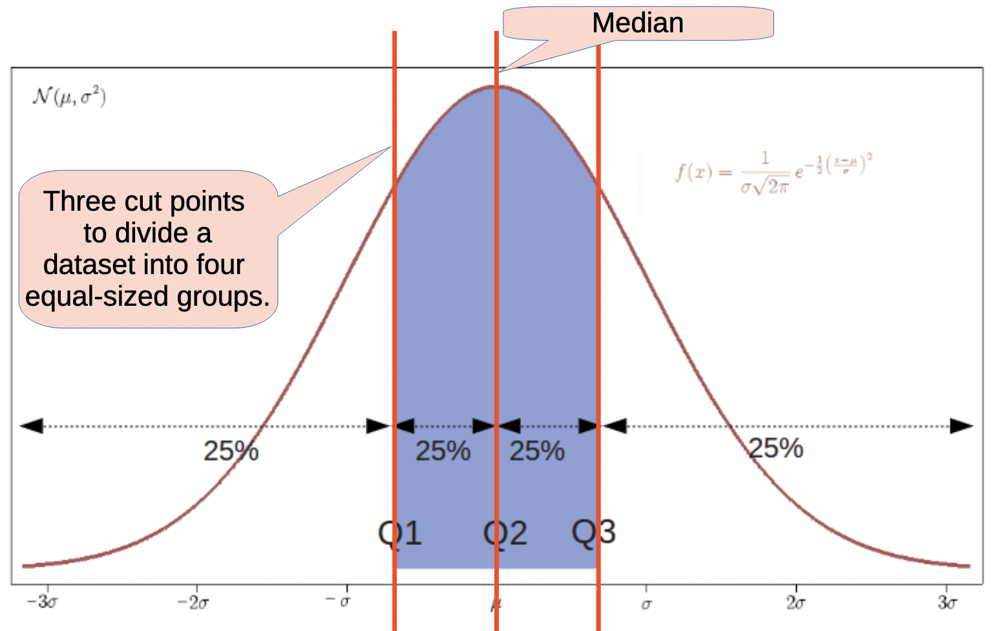{width=50%}

</center>

:::{.callout-tip icon="true"}
- Quartiles: Splits the data into four equal parts (Q₁ at 25%, Q₂ at 50%, Q₃ at 75%).
- Common quantiles include quartiles (4 parts), quintiles (5 parts), and percentiles (100 parts).
- Useful when summarizing data spread, central tendency, and range 
:::

## Let's See That in Code
```{r quanrtiles}
# Generate some sample data
set.seed(301)
data <- rnorm(100)

#cat(data) # Uncomment to see the data

# Calculate quantiles: How much of the data is below a certain value?
quantile(data, probs = c(0.25, 0.5, 0.75))
summary(data)
```

## A Function to Check Normality of Data

:::{.callout-blue}
If your data is normally distributed, the points in the Q-Q plot will fall approximately along the reference line. Deviations from this line indicate departures from normality.
:::

```{r quartile-plot1}
#| echo: true
#| fig-align: center
 
library(tidyverse)

# Quartiles
myQuartilePlot <- function(data) {
  # Create a data frame for ggplot
  df <- data.frame(value = data)
  
  # Create the quantile plot
  ggplot(df, aes(sample = value)) +
    stat_qq() +
    stat_qq_line() +
    labs(title = "Quantile-Quantile Plot",
         x = "Theoretical Quantiles",
         y = "Sample Quantiles") +
    theme_minimal()
}

# Generate some sample data
set.seed(301)
data <- rnorm(100)

myQuartilePlot(data)
```


## A Function to Check Normality of Data Plot

:::{.callout-blue}
In normal distributions, the points will align with the reference line.
:::

```{r quartile-plot2}
#| echo: false
#| fig-align: center

library(tidyverse)

# Quartiles
myQuartilePlot <- function(data) {
  # Create a data frame for ggplot
  df <- data.frame(value = data)
  
  # Create the quantile plot
  ggplot(df, aes(sample = value)) +
    stat_qq() +
    stat_qq_line() +
    labs(title = "Quantile-Quantile Plot",
         x = "Theoretical Quantiles",
         y = "Sample Quantiles") +
    theme_minimal()
}

# Generate some sample data
# set.seed(301)
# data <- rnorm(100)

myQuartilePlot(data)
```

---

# Correlation: Testing for Relationships Between Two Continuous Variables


:::{callout-important}

- What does a correlation coefficient tell us?
- How we test for correlation in R?
:::

---

## Correlation: A Relatedness Measure

::: {.callout-important icon="true"}
- A correlation coefficient measures the strength and direction of the linear relationship between two continuous variables.

- **Correlation coefficients range from -1 (negative) to 1 (positive), with values closer to -1 or 1 indicating stronger relationships.** 
:::

<center>

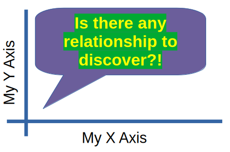{width=45%}

</center>

---

## Positive Correlation

::: {.callout-blue icon="false"}

Positive correlation: as one variable increases, the other also increases.

:::

<center>

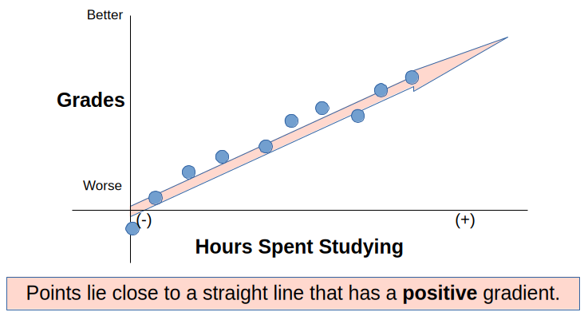{width=80%}

</center>


## Negative Correlation

::: {.callout-blue icon="false"}

Negative correlation: as one variable increases, the other decreases.

:::

<center>

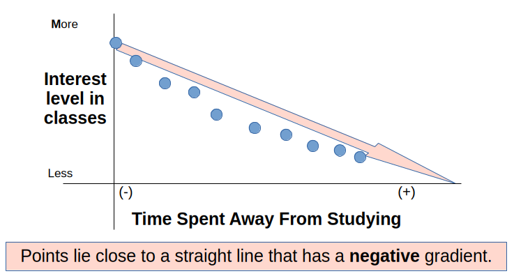{width=80%}

</center>


## Neutral Correlation

::: {.callout-blue icon="false"}

Neutral correlation: the increase in one variable is not related to the increase in the other.

:::

<center>

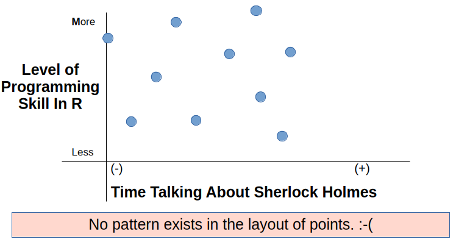{width=80%}

</center>


## All Correlations

::: {.callout-blue icon="false"}

All correlations: positive, negative, and neutral correlations.

:::

<center>

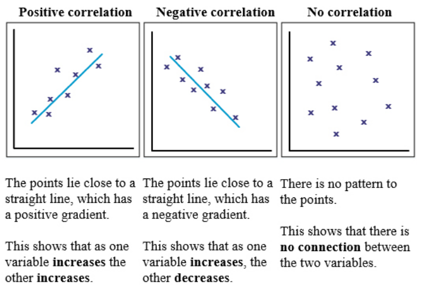{width=80%}

</center>


## Correlations with Numerical Values

::: {.callout-blue icon="false"}

Different types of correlation coefficients exist, such as Pearson's correlation coefficient (for linear relationships) and Spearman's rank correlation coefficient (for monotonic relationships).

:::

<center>

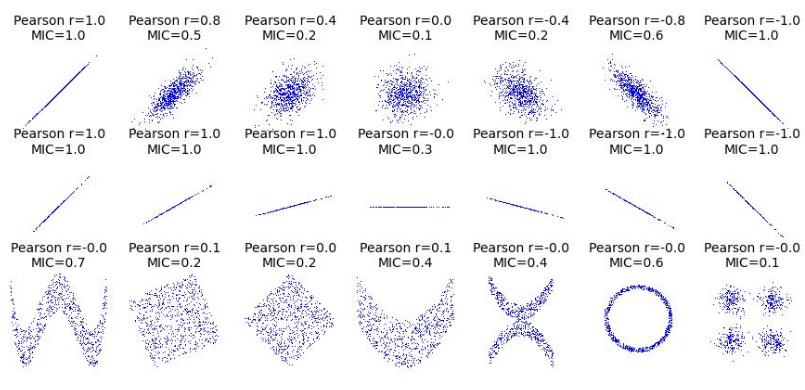{width=80%}

</center>

## Correlations with Numerical Values

::: {.callout-blue icon="false"}

The correlation coefficient is a unitless measure; it does not depend on the units of the variables being measured.

:::

<center>

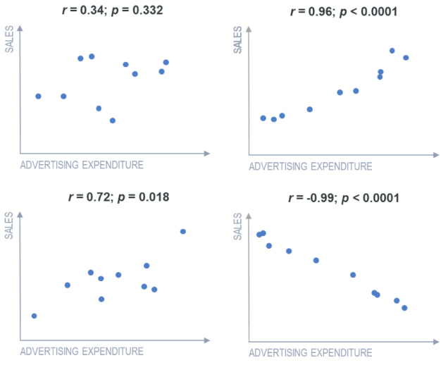{width=60%}

</center>

---

## Correlation Coefficients
::: {.callout-tip icon="true"}
Correlation measures the strength and direction of the linear relationship between two continuous variables. The correlation coefficient ranges from -1 to 1, where:

- 1 indicates a perfect positive linear relationship
- 0.5 indicates a moderate positive linear relationship
- 0 indicates no linear relationship
- -0.5 indicates a moderate negative linear relationship
- -1 indicates a perfect negative linear relationship
:::

## Code for Correlations in R Part 1

```{r correlation-code1}
# Online help? Use ?cor or help(cor)
# to get help on the cor() function

# Two simple vectors
cor(1:10, 2:11) # == 1
cor(1:10, -2:-11) # == -1

# matrix
cor(longley)
# Correlation Matrix of Multivariate sample:
(Cl <- cor(longley))
# Graphical Correlation Matrix:
symnum(Cl) # highly correlated
# Pearson’s r
symnum(clP <- cor(longley, method = "pearson")) #default
```

## Code for Correlations in R Part 2

```{r correlation-code2}
# Spearman's rho, Kendall's tau and
# Data is of non-bivariate normal distribution
symnum(clS <- cor(longley, method = "spearman"))
symnum(clK <- cor(longley, method = "kendall"))

# How much do they differ?
i <- lower.tri(Cl)
cor(cbind(P = Cl[i], S = clS[i], K = clK[i]))
```

---

# Variance and Standard Deviation


:::{callout-important}
- How spread out is the data?
- Does the data have a lot of variability about the mean?
:::

## Whats the Spread of the Data?

::: {.callout-blue icon="false"}

::: {style="color: #8E44AD; text-align: center; margin-top: 20px;"}
How spread out is the data? Does the data have a lot of variability about the mean?
:::

Variance is a measure of how spread out the data is from the mean. It is calculated by taking the average of the squared differences from the mean.

:::
<center>

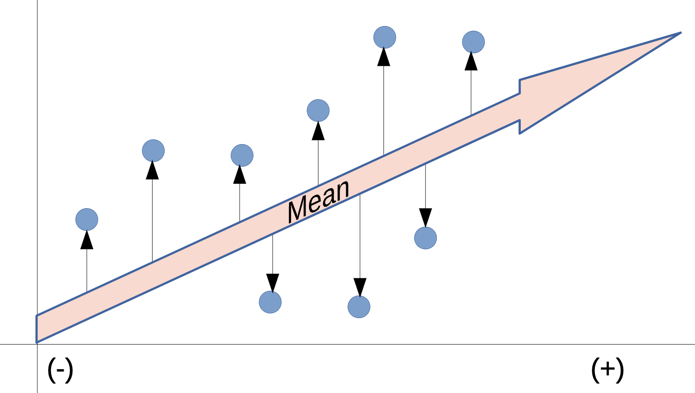{width=90%}

</center>

## Variance

::: {.callout-tip icon="false"}

Variance is expressed in the squared units of the data, which can make it less interpretable than standard deviation.

The formula for variance (*sigma squared*) is: $\sigma^2 = \frac{\sum_{i=1}^{N} (x_i - \mu)^2 }{N}$

Where,

- $\sigma$ is the standard deviation 
- $N$ is the number of observations 
- $x_i$ is the $i$-th observation 
- $\mu$ is the mean.

:::

## Code to Calculate Variance

```{r variance-code}
myData <- c( 9, 2, 5, 4, 12, 7, 8, 11, 9, 3, 7, 4, 12, 5, 4, 10, 9, 6, 9, 4)
var(myData) # Variance is 9.368421

# Standard Deviation
sqrt(var(myData)) # Standard deviation is 3.060788
```

```{r variance-code2}
myData <- c( NA, 2, 5, 4, 12, 7, 8, 11, 9, 3, 7, 4, 12, 5, 4, 10, 9, 6, 9, 4)

# The variance function cannot handle missing
# values by default, so it returns NA.
var(myData) # NA's in datasets create trouble. 

# Alternative way to calculate variance
var(myData, na.rm = TRUE) # Variance is 9.368421

```

---

## Standard Deviation

::: {.callout-blue icon="false"}
Standard deviation is the square root of the variance. It is a measure of the amount of variation or dispersion of a set of values.
:::

:::{.callout-tip icon="true"}
If variance is a measure of how spread out the data is, standard deviation is a measure of how much the data deviates from the mean. It is expressed in the same units as the data, making it more interpretable than variance.

The formula for standard deviation (*sigma*) is: $\sigma = \sqrt{\frac{\sum_{i=1}^{N} (x_i - \mu)^2 }{N}}$

Where,

- $\sigma$ is the standard deviation 
- $N$ is the number of observations 
- $x_i$ is the $i$-th observation 
- $\mu$ is the mean.

:::

## Standard Deviation Visually Part 1

<center>

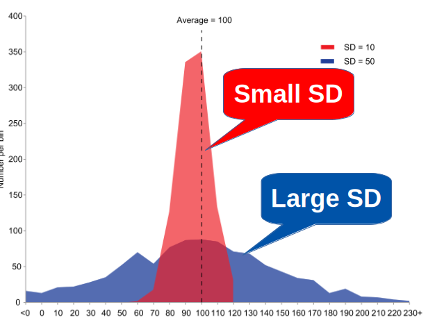{width=80%}

</center>

## Standard Deviation Visually Part 2

::: {.callout-tip icon="true"}

- **Large standard deviation** → data is spread out over a wider range of values.
  - *Large and Lazy*
- **Small standard deviation** → data is clustered closely around the mean.
  - *Small and Snug*
:::

<center>

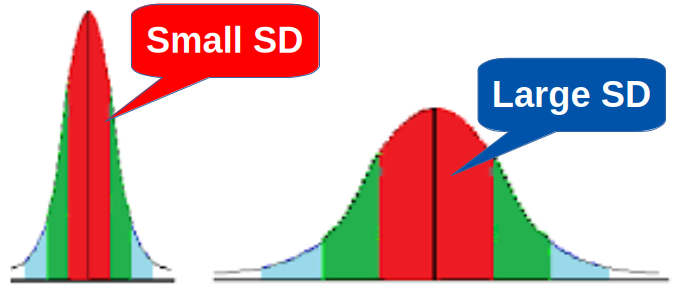{width=80%}

</center>

## How to Judge Standard Deviations

:::{.callout-tip icon="true"}
Instead of looking for a universal "good" or "bad" number, evaluate your SD using these three methods:

- Compare SD to the mean (Coefficient of Variation): Divide the standard deviation by the mean to see relative spread. A lower percentage means your data is tightly clustered around the average. 

- Compare SD to your requirements or limits.
  - Check if the expected spread fits inside your acceptable range. For a normally distributed bell curve, roughly 68% of data falls within 1 standard deviation of the mean, and 95% falls within 2 standard deviations. If 95% of your results fit inside your customer or project specifications, your variation is under control. 

- Compare it over time: Track the number across repeated runs. A rising standard deviation means your process is becoming less stable or predictable.

:::

:::{.callout icon="true"}
::: {style="color: #8E44AD; text-align: center; margin-top: 20px;"}

Above Details stolen indirectly from Wikipedia: https://en.wikipedia.org/wiki/Standard_deviation

:::
:::

## Standard Deviation Visually Part 3

<center>

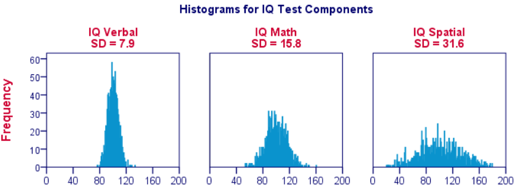{width=80%}

</center>

:::{.callout-tip icon="true"}
- How does the SD compare to your requirements or limits?
- How does the SD change over time?
:::

## Standard Deviation and Means

```{r more-sd1}
#| echo: true
#| fig-width: 6
#| fig-height: 2.2
#| out-width: "45%"
#| fig-align: center

library(ggplot2)

# Define the distributions
params <- data.frame(
  group = c("Low", "Moderate", "High", "Very high"),
  mean = c(10, 20, 30, 40),
  sd = c(2, 4, 6, 8)
)

# Generate density values for each distribution
set.seed(123)

data <- do.call(rbind, lapply(1:nrow(params), function(i) {
  x <- seq(
    params$mean[i] - 4 * params$sd[i],
    params$mean[i] + 4 * params$sd[i],
    length.out = 500
  )

  data.frame(
    x = x,
    density = dnorm(
      x,
      mean = params$mean[i],
      sd = params$sd[i]
    ),
    group = params$group[i]
  )
}))

# Plot the distributions
ggplot(data, aes(x = x, y = density, color = group)) +
  geom_line(linewidth = 1.2) +
  geom_vline(
    data = params,
    aes(xintercept = mean, color = group),
    linetype = "dashed",
    linewidth = 0.7,
    show.legend = FALSE
  ) +
  labs(
    title = "Increasing Means and Standard Deviations",
    subtitle = "Dashed lines indicate the means",
    x = "Value",
    y = "Probability density",
    color = "Distribution"
  ) +
  theme_minimal(base_size = 13)
```


## Standard Deviation and Means (Plot)

```{r more-sd3}
#| echo: false
#| fig-width: 10
#| fig-height: 5.5
#| fig-align: center

library(ggplot2)

# Define the distributions
params <- data.frame(
  group = c("Low", "Moderate", "High", "Very high"),
  mean = c(10, 20, 30, 40),
  sd = c(2, 4, 6, 8)
)

# Generate density values for each distribution
set.seed(123)

data <- do.call(rbind, lapply(1:nrow(params), function(i) {
  x <- seq(
    params$mean[i] - 4 * params$sd[i],
    params$mean[i] + 4 * params$sd[i],
    length.out = 500
  )

  data.frame(
    x = x,
    density = dnorm(
      x,
      mean = params$mean[i],
      sd = params$sd[i]
    ),
    group = params$group[i]
  )
}))

# Plot the distributions
ggplot(data, aes(x = x, y = density, color = group)) +
  geom_line(linewidth = 1.2) +
  geom_vline(
    data = params,
    aes(xintercept = mean, color = group),
    linetype = "dashed",
    linewidth = 0.7,
    show.legend = FALSE
  ) +
  labs(
    title = "Increasing Means and Standard Deviations",
    subtitle = "Dashed lines indicate the means",
    x = "Value",
    y = "Probability density",
    color = "Distribution"
  ) +
  theme_minimal(base_size = 13)
```


---

# The Logic of Testing 

:::{.callout-important}
- What is a null hypothesis?
- What is an alternative hypothesis?
- What is a p-value?
- How do we interpret a p-value?
:::
---

## The Courtroom Analogy 

::: {.columns}
::: {.column}
**In court**

- Presumption: **innocent**
- Evidence is gathered
- "Beyond reasonable doubt" → convict
- Otherwise → *not guilty* (**not** "proven innocent")
:::

::: {.column}
**In statistics**

- Presumption: **H₀, no effect**
- Data is gathered
- p < α → **reject H₀**
- Otherwise → *fail to reject* (**not** "H₀ is true")
:::
:::

::: {.callout-important icon="true"}
## "Fail to Reject" Is Not "Accept"
Absence of evidence is not evidence of absence. A tiny study can fail to detect
an enormous effect. 
:::

---

## The Vocabulary 

:::{.callout-tip icon="true"}
| Term | Meaning |
|:--|:--|
| **$H_0$ (null)** | The boring claim: no difference, no effect, no relationship |
| **$H_1$ (alternative)** | What you suspect is happening |
| **Test statistic** | A number summarizing how far your data is from H₀ |
| **p-value** | P(data this extreme **or more** \| H₀ is true) |
| **α (alpha)** | Your threshold, chosen *before* looking (usually 0.05) |
| **Type I error** | Rejecting a true H₀ — a false alarm (rate = α) |
| **Type II error** | Failing to reject a false H₀ — a miss (rate = β) |
| **Power** | 1 − β: your chance of detecting a real effect |
:::

---

## What a p-value Is NOT 🚫

::: {.callout-warning icon="true"}
## Four Very Common Errors
❌ "p = 0.03 means there is a 3% chance H₀ is true"  
❌ "p = 0.03 means a 97% chance the effect is real"  
❌ "p = 0.06 means there is no effect"  
❌ "p = 0.001 means the effect is large and important"
:::

::: {.callout-tip icon="true"}
## What It Actually Says
**"If there were truly no effect, data at least this extreme would appear
3% of the time."** That is all. It says nothing about the size or importance
of the effect. 📏
:::

---

## A SUPER Fast View of P-Values!

:::{.callout-tip icon="true"}
- If the *p*-value is small (< 0.05), we reject H₀. If the *p*-value is large, we fail to reject H₀.
- If the *p*-value is very small (< 0.01), we have stronger evidence for Ha.
:::

<center>
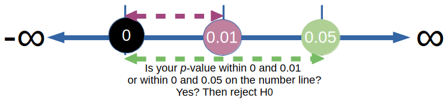{width=100%}
</center>


---

## A SUPER Fast Example with $H_0$ and $H_1$! 🍹

:::{.callout-tip icon="true"}
Let's say we're testing whether a new drink increases alertness. We have 30 participants, and we measure their alertness before and after drinking the new drink.

- $H_0$: The new drink has no effect on alertness.
- $H_1$: The new drink increases alertness.

We collect the data and find a *p*-value of 0.03, which is less than our significance level of 0.05. So we reject H₀ and conclude that the new drink increases alertness.
:::

<center>
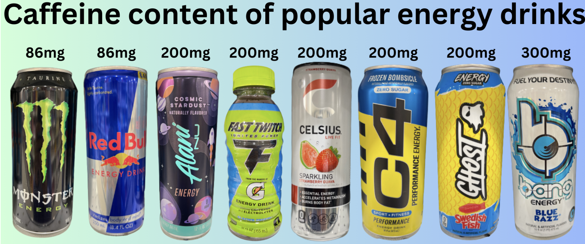{width=50%}
</center>

## Seeing the Null Distribution 👀

```{r null-distribution}
#| echo: true
#| fig-width: 11
#| fig-height: 3.8

library(tidyverse)
set.seed(301)

# Simulate H0 being TRUE: two groups from the same population
null_ts <- replicate(5000, {
  a <- rnorm(20, 100, 15)
  b <- rnorm(20, 100, 15)      # identical population!
  t.test(a, b)$statistic
})

observed <- 2.3   # pretend this is our real study's t statistic

ggplot(tibble(t = null_ts), aes(t)) +
  geom_histogram(bins = 60, fill = "#BDC3C7", color = "white") +
  geom_vline(xintercept = c(-observed, observed), color = "#E74C3C", linewidth = 1) +
  labs(title = "5,000 studies where H0 was true",
       subtitle = paste0("p-value = fraction beyond the red lines = ",
                         round(mean(abs(null_ts) >= observed), 4)),
       x = "t statistic", y = "Count") +
  theme_minimal(base_size = 12)
```

---

## Errors and Power 🎯

```{r error-types}
#| echo: true

# Power: if the true difference is 5 points (sd = 15), how often
# will a study with 30 per group detect it at alpha = 0.05?
power.t.test(n = 30, delta = 5, sd = 15, sig.level = 0.05)$power

# How many per group would we need for 80% power?
power.t.test(delta = 5, sd = 15, sig.level = 0.05, power = 0.80)$n
```

::: {.callout-warning icon="true"}
## Underpowered Studies Are Doubly Dangerous
They usually miss real effects — and when they *do* hit significance, the
estimated effect is **exaggerated**, because only large flukes clear the bar. 📈
:::

---

## One-Tailed or Two? 🔀

```{r tails}
#| echo: true

set.seed(301)
scores <- rnorm(30, mean = 104, sd = 15)

# Two-sided (default): "is it different from 100?"
t.test(scores, mu = 100)$p.value

# One-sided: "is it GREATER than 100?"
t.test(scores, mu = 100, alternative = "greater")$p.value
```

::: {.callout-important}
**Choose the direction before you see the data.** Switching to a one-tailed
test after a two-tailed test disappoints you is a textbook form of p-hacking. 🚨
:::

---

# Part 2: t-tests 🧪

:::{.callout-important}
- What is a t-test?
- How do we perform a t-test in R?
- How do we interpret the results of a t-test?
:::
---


## A Green Drink, a Purple Drink, and a *p*-value! 🍹

:::{.callout-important icon="true"}
Imagine your company bottles two drinks: green and purple. You suspect that the Green drink bottles are filled to higher levels by the green machine than the Purple machine fills its purple bottles. 
:::

<center>

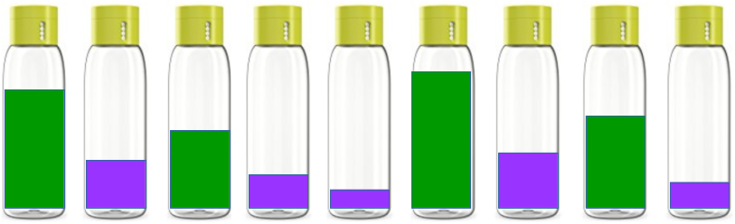{width=90%}

</center>


## Green and Purple: Form an Experiment and Collect Data! 🍹


::: {.callout-important icon="true"}

- Suppose: Each drink comes in a bottle and we would like to know whether the green and the purple drinks are filled to the same levels.
  - Implying that that the green and purple machines are calibrated to fill the bottles to the **same** levels. 
  - *Is this true?*
- We randomly select 9 *random* bottles from our entire set of 100000 bottles. Note: this is actually a very small sample size, but we are just doing this for demonstration purposes!
- Statistics is used to extrapolate our findings from the small set to the larger set of bottles. 
:::

::: {.callout-note}

::: {style="color: #8E44AD; text-align: center; margin-top: 20px;"}
We formulate our hypotheses to test the claim that the green and purple drinks are filled to the same levels.

- **$H_0$**: The green and purple drinks are filled to the same levels (no difference).
- **$H_1$**: The green and purple drinks are filled to different levels (there is a difference).
::: 
:::


## Green and Purple: Our Selection

:::{.callout-important icon="true"}
We randomly select 9 bottles of each drink and measure the fill levels. These nine bottles are used to represent the total population of bottles, and to test our hypotheses. 
:::


The data is as follows:

- Green drink: 102, 107, 111, 110, 112, 115, 118, 120, 122
- Purple drink: 98, 100, 102, 102, 107, 110, 113, 104, 111

<center>

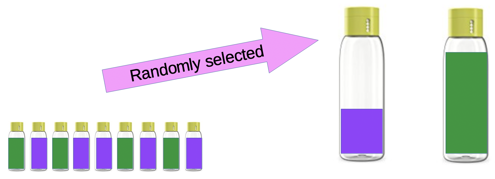{width=50%}

</center>


## Green and Purple: The Test To Determine a Difference

::: {.callout-note}

## t-tests to Compare Means Between Samples

- Non-parametric "Two Sample" t-tests are used to compare the means of two independent groups.
  - Here, we have two independent groups: the green drink and the purple drink. 
  - The t-test determines whether there is difference in fill levels between the two drinks is statistically significant, or if any difference could have occurred by random chance.
- The t-test provides a *p*-value to inform us which hypothesis to accept or reject.
:::

:::{.callout-important icon="true"}
- If the *p*-value is less than 0.05, we reject the null hypothesis
  - Conclude that there is a statistically significant difference in fill levels between the green and purple drinks.
- If the *p*-value is greater than 0.05, we fail to reject the null hypothesis 
  - Conclude that there is not enough evidence to suggest a statistically significant difference in fill levels between the green and purple drinks.
:::

## Green and Purple: Running the t-test:

```{r t-test-data}
# Create vectors for the fill levels of each drink
green <- c(102, 107, 111, 110, 112, 115, 118, 120, 122)
purple <- c(98, 100, 102, 102, 107, 110, 113, 104, 111)

# Perform the t-test
t.test(green, purple)

```


---

## A SUPER Fast View of P-Values (Again!)

:::{.callout-tip icon="true"}
- If the *p*-value is small (< 0.05), we reject H₀. If the *p*-value is large, we fail to reject H₀.
- If the *p*-value is very small (< 0.01), we have stronger evidence for Ha.
:::

<center>
{width=100%}
</center>

::: {.callout-blue}
**Interpretation of the p-value for Green and Purple Drinks:**
The *p*-value = 0.01293 and so we reject the null hypothesis and conclude that there is a statistically significant difference in fill levels between the green and purple drinks.
:::

---


## One-Sample t-test

::: {.callout icon="false"}
**Question:** is this sample's mean different from a specific value?
:::

```{r one-sample-t}
#| echo: true
#| fig-align: center 
library(tidyverse)
# Is the average mpg in mtcars different from 20?
t.test(mtcars$mpg, mu = 20)
```

```{r one-sample-t-mean}
# mean of mtcars$mpg
mean(mtcars$mpg)
```

---

## One-Sample t-test: Visualizing the Null Distribution

```{r one-sample-t-plot}
#| echo: true
#| fig-align: center 

library(tidyverse)
# Create a histogram of the sample data
ggplot(mtcars, aes(x = mpg)) +
  geom_histogram(bins = 10, fill = "lightblue", color = "black", alpha = 0.7) +
  geom_vline(xintercept = 20, color = "red", linetype = "dashed", size = 1) +
  geom_vline(xintercept = mean(mtcars$mpg), color = "blue", linetype = "dashed", size = 1) +
  labs(title = "Null Distribution for One-Sample t-test",
       x = "MPG",
       y = "Frequency") +
  theme_minimal()
```

---


## Yet ANOTHER Two-Sample t-test (`mtcars`)

```{r two-sample-t}
#| echo: true
#| fig-width: 10
#| fig-height: 3.6

# Do manual cars get better mileage?
t.test(mpg ~ am, data = mtcars)
```

::: {.callout}
R defaults to **Welch's t-test**, which does not assume equal variances. That
is the safer default — keep it. ✅
:::

---

## As a plot, the difference is clear

```{r ttest-plot}
#| echo: true
#| fig-width: 10
#| fig-height: 1.8
#| fig-align: center
library(tidyverse)
ggplot(mtcars,
# Note, factor(am) places transmission type
# on the x-axis as a category.
       aes(factor(am), mpg, 
           fill = factor(am))) +
  geom_boxplot(alpha = 0.7) +
# geo_jitter() adds the points to box plots
  geom_jitter(width = 0.12, size = 2) +
  scale_x_discrete(
    labels = c("Automatic", "Manual")) +
  scale_fill_manual(
    values = c("#3498DB", "#E67E22")) +
  labs(x = NULL, y = "MPG") +
  theme_minimal(base_size = 12) +
  theme(legend.position = "none")

```
---

## Paired t-test 👯

::: {.callout-important icon="false"}
A **PAIRED t-TEST** checks whether the mean difference between two matched or related measurements is equal to zero. Good for "before and after" studies, or when the same subjects are measured under two different conditions.
:::

```{r paired-t}
#| echo: true

data(sleep) # 10 sleep patients, two different drugs each
#help(sleep) # for details
# WRONG type of test: treats the 20 measurements as independent
t.test(extra ~ group, data = sleep)$p.value

# RIGHT type of test: the same 10 patients took both drugs
# (modern R wants the two vectors, not a formula, when paired = TRUE)
pvalue <- with(sleep, t.test(extra[group == 1], extra[group == 2], paired = TRUE))$p.value
cat("The p-value for the paired t-test is: ", pvalue, "\n")
```

::: {.callout-note}
Pairing removes person-to-person variation, so it is far more sensitive. Same
data, *p* drops from 0.079 to 0.003 — **the design matters more than the test**. 🎯
:::

---

## Cohen's d: Effect Size for t-tests

::: {.callout-important icon="true"}
- Calculated as the difference in means divided by the pooled standard deviation.

- Used to interpret the practical significance of a t-test result. It helps us understand whether the observed difference between groups is meaningful in a real-world context.

See more about Cohen's d here: <a href="https://en.wikipedia.org/wiki/Effect_size#Cohen's_d" target="_blank">https://en.wikipedia.org/wiki/Effect_size#Cohen's_d</a> or <a href="https://statisticsbyjim.com/basics/cohens-d/" target="_blank">https://statisticsbyjim.com/basics/cohens-d/</a>.
:::


:::{.callout-blue icon="true"}
Chohen's d is calculated as:

$d$ = $\frac{\bar{x}_1 - \bar{x}_2}{s_p}$
:::


## Effect Size: The Missing Number 📏

```{r effect-size}
#| echo: true

# Cohen's d: the difference in standard deviation units
cohens_d <- function(x, y) {
  nx <- length(x); ny <- length(y)
  pooled_sd <- sqrt(((nx - 1) * var(x) + (ny - 1) * var(y)) / (nx + ny - 2))
  (mean(x) - mean(y)) / pooled_sd
}

manual    <- mtcars$mpg[mtcars$am == 1]
automatic <- mtcars$mpg[mtcars$am == 0]

round(cohens_d(manual, automatic), 2)
```
:::{.callout-blue}
| Cohen's d | Conventional label |
|:--|:--|
| 0.2 | small |
| 0.5 | medium |
| 0.8 | large |
:::

::: {.callout-important}
**Always report an effect size and a confidence interval alongside p.** With
n = 10,000, a meaningless difference gets p < 0.001. 📊
:::

---

## Checking Assumptions 🩺

```{r assumptions}
#| echo: true
#| fig-width: 11
#| fig-height: 3.4

# 1. Normality of each group (matters most for small n)
shapiro.test(mtcars$mpg[mtcars$am == 1])$p.value

# 2. Equal variances (only if you use var.equal = TRUE)
var.test(mpg ~ am, data = mtcars)$p.value

# 3. Independence - a design question, not a test!

library(patchwork)
p1 <- ggplot(mtcars, aes(sample = mpg)) +
  stat_qq(color = "#2E86C1") + stat_qq_line(color = "#E74C3C") +
  labs(title = "Q-Q plot: points on the line = normal") +
  theme_minimal(base_size = 11)

p2 <- ggplot(mtcars, aes(mpg)) +
  geom_histogram(bins = 12, fill = "#3498DB", color = "white") +
  labs(title = "Histogram") + theme_minimal(base_size = 11)

p1 + p2
```

::: {.callout-warning}
Normality tests are themselves underpowered at small n and hypersensitive at
large n. **Look at the Q-Q plot.** 👀
:::

---

## Interactive: t-Test Builder 🎮

```{=html}
<!-- Global copy to clipboard function -->
<script>
function copyToClipboard(elementId, buttonElement) {
  const element = document.getElementById(elementId);
  const text = element.textContent;

  navigator.clipboard.writeText(text).then(function() {
    // Visual feedback
    const originalText = buttonElement.innerHTML;
    buttonElement.innerHTML = '✓ Copied!';
    buttonElement.classList.add('copied');

    setTimeout(function() {
      buttonElement.innerHTML = originalText;
      buttonElement.classList.remove('copied');
    }, 2000);
  }).catch(function(err) {
    console.error('Failed to copy:', err);
    buttonElement.innerHTML = '❌ Error';
    setTimeout(function() {
      buttonElement.innerHTML = '📋 Copy';
    }, 2000);
  });
}
</script>

<div class="interactive-tool">
  <h3>🧪 t-Test Builder</h3>

  <div class="tool-controls">
    <div class="control-group">
      <label>Your design:</label>
      <select id="tt-design">
        <option value="one">One group vs a fixed value</option>
        <option value="two">Two independent groups</option>
        <option value="paired">Paired / repeated measures</option>
      </select>
    </div>

    <div class="control-group">
      <label>Direction:</label>
      <select id="tt-alt">
        <option value="two.sided">Two-sided (different)</option>
        <option value="greater">One-sided (greater)</option>
        <option value="less">One-sided (less)</option>
      </select>
    </div>

    <div class="control-group">
      <label>Example data:</label>
      <select id="tt-data">
        <option value="mtcars">mtcars (mpg by transmission)</option>
        <option value="iris">iris (Sepal.Length by species)</option>
        <option value="sleep">sleep (paired drug trial)</option>
        <option value="ToothGrowth">ToothGrowth (len by supplement)</option>
      </select>
    </div>
  </div>

  <div style="display: grid; grid-template-columns: repeat(3, 1fr); gap: 8px; margin-top: 10px;">
    <label><input type="checkbox" id="tt-check" checked> assumption checks</label>
    <label><input type="checkbox" id="tt-effect" checked> effect size</label>
    <label><input type="checkbox" id="tt-plot"> plot</label>
  </div>

  <div class="tool-buttons">
    <button class="tool-button" onclick="generateTTest()">Generate Code</button>
    <button class="tool-button secondary" onclick="showTTestReport()">How to Report It</button>
    <button class="tool-button secondary" onclick="clearTTestTool()">Clear</button>
  </div>

  <div class="tool-output-container">
    <button class="copy-button" onclick="copyToClipboard('tt-output', this)">📋 Copy</button>
    <div class="tool-output" id="tt-output">Describe your design and click "Generate Code"!</div>
  </div>
</div>

<script>
const ttData = {
  mtcars: {call: 'mpg ~ am, data = mtcars', v: 'mtcars$mpg', g: 'mtcars$am', label: 'MPG by transmission'},
  iris: {call: 'Sepal.Length ~ Species, data = subset(iris, Species != "setosa")', v: 'iris$Sepal.Length', g: 'iris$Species', label: 'Sepal length by species'},
  sleep: {call: 'extra ~ group, data = sleep', v: 'sleep$extra', g: 'sleep$group', label: 'Extra sleep by drug'},
  ToothGrowth: {call: 'len ~ supp, data = ToothGrowth', v: 'ToothGrowth$len', g: 'ToothGrowth$supp', label: 'Tooth length by supplement'}
};

function generateTTest() {
  const design = document.getElementById('tt-design').value;
  const alt = document.getElementById('tt-alt').value;
  const key = document.getElementById('tt-data').value;
  const d = ttData[key];
  const checks = document.getElementById('tt-check').checked;
  const effect = document.getElementById('tt-effect').checked;
  const plot = document.getElementById('tt-plot').checked;

  let code = 'library(tidyverse)\n\n';
  code += '# Design: ' + design + ' sample | Data: ' + d.label + '\n\n';

  if (checks) {
    code += '# --- Step 1: LOOK at the data first --------------\n';
    if (design === 'one') {
      code += 'summary(' + d.v + ')\n';
      code += 'shapiro.test(' + d.v + ')      # normality\n\n';
    } else {
      code += 'aggregate(' + d.call.split(',')[0] + ',\n';
      code += '          data = ' + key + ', FUN = function(x) c(mean = mean(x), sd = sd(x)))\n';
      code += 'var.test(' + d.call + ')       # equal variances?\n\n';
    }
  }

  code += '# --- Step 2: run the test ------------------------\n';
  if (design === 'one') {
    code += 'result <- t.test(' + d.v + ', mu = 20, alternative = "' + alt + '")\n';
  } else if (design === 'two') {
    code += '# Welch t-test (does NOT assume equal variances) is the default\n';
    code += 'result <- t.test(' + d.call + ', alternative = "' + alt + '")\n';
  } else {
    code += '# paired = TRUE needs TWO VECTORS in matching order,\n';
    code += '# not a formula (that combination was removed in modern R).\n';
    code += 'groups <- split(' + d.v + ', ' + d.g + ')\n';
    code += 'result <- t.test(groups[[1]], groups[[2]],\n';
    code += '                 paired = TRUE, alternative = "' + alt + '")\n';
  }
  code += 'result\n\n';
  code += '# Pull out the pieces you need for writing\n';
  code += 'result$statistic     # t\n';
  code += 'result$parameter     # df\n';
  code += 'result$p.value       # p\n';
  code += 'result$conf.int      # the interval that matters most\n\n';

  if (effect) {
    code += '# --- Step 3: effect size -------------------------\n';
    code += 'cohens_d <- function(x, y) {\n';
    code += '  nx <- length(x); ny <- length(y)\n';
    code += '  s_pooled <- sqrt(((nx - 1) * var(x) + (ny - 1) * var(y)) / (nx + ny - 2))\n';
    code += '  (mean(x) - mean(y)) / s_pooled\n';
    code += '}\n\n';
    if (design === 'one') {
      code += '# One sample: d = (mean - mu) / sd\n';
      code += '(mean(' + d.v + ') - 20) / sd(' + d.v + ')\n\n';
    } else {
      code += 'groups <- split(' + d.v + ', ' + d.g + ')\n';
      code += 'cohens_d(groups[[1]], groups[[2]])\n\n';
    }
  }

  if (plot) {
    code += '# --- Step 4: show it ------------------------------\n';
    if (design === 'one') {
      code += 'ggplot(' + key + ', aes(x = ' + d.v.split('$')[1] + ')) +\n';
      code += '  geom_histogram(bins = 15, fill = "#3498DB", color = "white") +\n';
      code += '  geom_vline(xintercept = 20, color = "#E74C3C", linewidth = 1) +\n';
      code += '  labs(title = "Sample vs the hypothesized value") +\n';
      code += '  theme_minimal()\n';
    } else {
      const yv = d.call.split(' ~ ')[0];
      const gv = d.call.split(' ~ ')[1].split(',')[0];
      code += 'ggplot(' + key + ', aes(x = factor(' + gv + '), y = ' + yv + ',\n';
      code += '                  fill = factor(' + gv + '))) +\n';
      code += '  geom_boxplot(alpha = 0.7) +\n';
      code += '  geom_jitter(width = 0.12, alpha = 0.6) +\n';
      code += '  scale_fill_manual(values = c("#3498DB", "#E67E22")) +\n';
      code += '  labs(title = "' + d.label + '", x = NULL) +\n';
      code += '  theme_minimal() + theme(legend.position = "none")\n';
    }
  }

  document.getElementById('tt-output').textContent = code;
}

function showTTestReport() {
  let code = '# How to report a t-test in writing 📝\n\n';
  code += '# Template:\n';
  code += '#   "Manual cars averaged 24.4 mpg (SD = 6.2, n = 13) compared with\n';
  code += '#    17.1 mpg (SD = 3.8, n = 19) for automatics. Welch\'s t-test found\n';
  code += '#    this difference unlikely under the null hypothesis,\n';
  code += '#    t(18.3) = 3.77, p = 0.001, 95% CI [3.2, 11.3], Cohen\'s d = 1.48."\n\n';
  code += '# Every report needs FIVE things:\n';
  code += '#   1. The descriptive statistics (means, SDs, n)\n';
  code += '#   2. The test and its statistic with df\n';
  code += '#   3. The p-value (report it exactly, not "p < 0.05")\n';
  code += '#   4. A confidence interval for the difference\n';
  code += '#   5. An effect size\n\n';
  code += '# Build the sentence automatically:\n';
  code += 'tt <- t.test(mpg ~ am, data = mtcars)\n';
  code += 'sprintf("t(%.1f) = %.2f, p = %.3f, 95%% CI [%.1f, %.1f]",\n';
  code += '        tt$parameter, tt$statistic, tt$p.value,\n';
  code += '        tt$conf.int[1], tt$conf.int[2])\n\n';
  code += '# Watch the sign: R compares am = 0 (automatic) with am = 1,\n';
  code += '# so it reports -3.77 and [-11.3, -3.2]. Flip the sign if you\n';
  code += '# write the sentence as "manual minus automatic".\n\n';
  code += '# Never write: "the groups were not significantly different,\n';
  code += '# so they are the same." That claim needs an equivalence test.\n';

  document.getElementById('tt-output').textContent = code;
}

function clearTTestTool() {
  ['tt-design','tt-alt','tt-data'].forEach(function(id) {
    document.getElementById(id).selectedIndex = 0;
  });
  document.getElementById('tt-check').checked = true;
  document.getElementById('tt-effect').checked = true;
  document.getElementById('tt-plot').checked = false;
  document.getElementById('tt-output').textContent =
    'Describe your design and click "Generate Code"!';
}
</script>
```

---

## Knowledge Check 🧠

```{=html}
<div class="quiz-box">
  <div class="quiz-question">
    A study reports p = 0.04. Which statement is correct?
  </div>

  <div class="quiz-options">
    <div class="quiz-option" onclick="checkTestQuiz1(this, false)">There is a 4% chance the null hypothesis is true</div>
    <div class="quiz-option" onclick="checkTestQuiz1(this, false)">The effect is real with 96% certainty</div>
    <div class="quiz-option" onclick="checkTestQuiz1(this, true)">If there were no real effect, data this extreme would occur about 4% of the time</div>
    <div class="quiz-option" onclick="checkTestQuiz1(this, false)">The effect is small but statistically meaningful</div>
  </div>

  <div id="test-quiz1-feedback" style="display: none;"></div>
</div>

<script>
function checkTestQuiz1(element, isCorrect) {
  const box = element.closest('.quiz-box');
  box.querySelectorAll('.quiz-option').forEach(function(opt) {
    opt.classList.remove('correct', 'incorrect');
  });
  element.classList.add(isCorrect ? 'correct' : 'incorrect');
  const feedback = document.getElementById('test-quiz1-feedback');
  feedback.style.display = 'block';
  feedback.className = 'quiz-feedback ' + (isCorrect ? 'correct' : 'incorrect');
  if (isCorrect) {
    feedback.textContent = '✅ Correct! The p-value is computed ASSUMING the null is true. It cannot then tell you the probability that the null is true — that would be circular.';
  } else {
    feedback.textContent = '❌ Not quite! Remember the conditional direction: p = P(data | H0), never P(H0 | data).';
  }
}
</script>
```

---

<!-- # Part 3: ANOVA 📊

---

## Why Not Just Run Many t-tests? 🚨

```{r multiple-comparisons}
#| echo: true
#| fig-width: 11
#| fig-height: 3.2

set.seed(301)

# Five groups, ALL from the same population - no real differences at all
false_positive <- function(k) {
  groups <- map(1:k, \(i) rnorm(20, 100, 15))
  pairs  <- combn(k, 2)
  ps <- apply(pairs, 2, \(idx) t.test(groups[[idx[1]]], groups[[idx[2]]])$p.value)
  any(ps < 0.05)          # did ANY comparison "find" something?
}

rates <- map_dbl(2:8, \(k) mean(replicate(400, false_positive(k))))

tibble(groups = 2:8, rate = rates) %>%
  ggplot(aes(groups, rate)) +
  geom_col(fill = "#E74C3C") +
  geom_hline(yintercept = 0.05, linetype = "dashed") +
  scale_y_continuous(labels = scales::percent) +
  labs(title = "Chance of at least one false positive when NOTHING is going on",
       x = "Number of groups compared", y = "False positive rate") +
  theme_minimal(base_size = 12)
```
 -->
