<!-- ::: {style="color: #8E44AD; text-align: center; margin-top: 20px;"}
**A p-value answers one narrow question. Know exactly which one.** 
::: -->


# What's On For Today? 🔬

::: {.callout-tip icon="true"}

**Formal Statistical Inference**

* **ANOVA** - comparing three or more groups
* **Post-hoc Tests** - *which* groups differ?
* **Diagnostics** - checking the assumptions
* **p-hacking** - how testing goes wrong
:::

::: {style="color: #8E44AD; text-align: center; margin-top: 20px;"}
**A p-value answers one narrow question. Know exactly which one.** 
:::

## A New Test

:::{.callout-important icon="true"}
- **ANOVA** (Analysis of Variance) is a statistical method used to compare the means of three or more groups.
- Allows to determine the existence of significant differences between group means without inflating the Type I error rate (More on *Error Types* later).
:::

:::{.callout-note icon="true"}
## Simple Examples of ANOVA Uses:
- Independent variable is social media use, and you assign groups to low, medium, and high levels of social media use.
- Dependent variable is hours of sleep per night.
- Find out if there is a difference in hours of sleep per night

:::


## Avoiding Type-I Errors

:::{.callout-important}
- When there are more than two groups, running multiple t-tests increases the chance of making a Type I error (false positive).
- ANOVA avoids this issue by testing all groups simultaneously.
:::

:::{.callout-important icon="true"}
## Type Errors:
- Correct Interpretation of Results
  - **Type I Error:** Rejecting the null hypothesis when it is true (false positive).
  - **Type II Error:** Failing to reject the null hypothesis when it is false (false negative).
- Misinterpretation of Results
  - **Type III Error:** Correctly rejecting the null hypothesis but for the wrong reason.
  - **Type IV Error:** Failing to reject the null hypothesis when it is false, and doing so for the wrong reason.
:::

## Hey, Is There A, Like, a Huge and Ugly Type-Error Chart??

<center>

{width="60%"}

</center>

## There Sure Is! Error Types as a Matrix

<center>

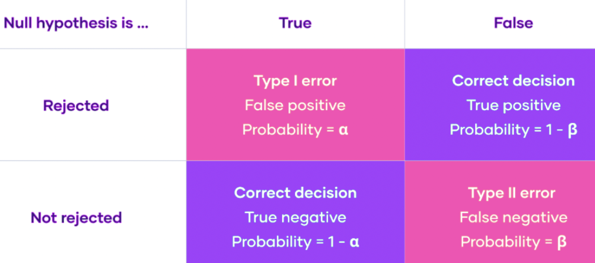{width="100%"}
</center>


<!-- ## But First! Dependent and Independent Variables 

:::{.callout-tip icon="true"}
- **Dependent Variable:** The outcome or response variable that you are measuring.
- **Independent Variable:** The variable that is manipulated or controlled in the experiment.
:::

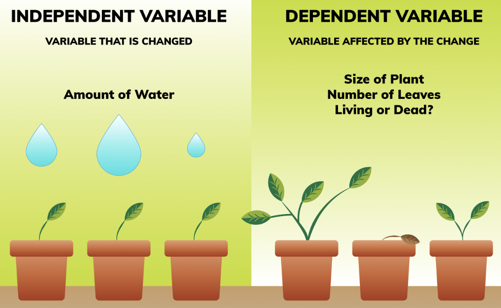{fig-align="center" width="600"}
 -->

---

## Assumptions of ANOVA

:::{.callout-tip icon="true"}
1. **Independence of Observations:** Each observation should be independent of the others.
2. **Normality:** The residuals (errors) should be normally distributed.
3. **Homogeneity of Variance:** The variances across groups should be approximately equal.
:::

```{r normality-check}
#| echo: false
#| fig-width: 11
#| fig-height: 3.8
library(tidyverse)
x <- seq(-4, 4, length.out = 300)

tibble(x = x, density = dnorm(x)) %>%
  ggplot(aes(x, density)) +
  geom_area(data = ~ filter(.x, x >= -1, x <= 1),
   fill = "#27AE60", alpha = 0.5) +
  geom_area(data = ~ filter(.x, x >= -2, x <= 2),
   fill = "#3498DB", alpha = 0.25) +
  geom_line(linewidth = 1) +
  annotate("text", x = 0, y = 0.15,
   label = "68%", size = 5, color = "white") +
  annotate("text", x = 1.5, y = 0.05,
   label = "95%", size = 4.5, color = "#2E86C1") +
  labs(title = "The 68-95-99.7 rule",
       subtitle = "Within 1, 2, and 3 standard deviations of the mean",
       y = "Density") +
  theme_minimal(base_size = 12)

```

---

## Why Not Just Run Many t-tests? (code)

```{r multiple-comparisons-code}
#| echo: true
#| eval: true
#| fig-width: 11
#| fig-height: 3.2
#| fig-center: true
library(tidyverse)
set.seed(301)

# Five groups, ALL from the same population - no real differences at all
false_positive <- function(k) {
  groups <- map(1:k, \(i) rnorm(20, 100, 15))
  pairs  <- combn(k, 2)
  ps <- apply(pairs, 2, \(idx) t.test(groups[[idx[1]]], groups[[idx[2]]])$p.value)
  any(ps < 0.05)          # did ANY comparison "find" something?
}

rates <- map_dbl(2:8, \(k) mean(replicate(400, false_positive(k))))

tibble(groups = 2:8, rate = rates) %>%
  ggplot(aes(groups, rate)) +
  geom_col(fill = "#E74C3C") +
  geom_hline(yintercept = 0.05, linetype = "dashed") +
  scale_y_continuous(labels = scales::percent) +
  labs(title = "Chance of at least one false positive when NOTHING is going on",
       x = "Number of groups compared", y = "False positive rate") +
  theme_minimal(base_size = 12)
```


## Why Not Just Run Many t-tests (plot)?

```{r multiple-comparisons-plot}
#| echo: false
#| eval: true
#| fig-width: 11
#| fig-height: 3.2
#| fig-center: true
library(tidyverse)
set.seed(301)

# Five groups, ALL from the same population - no real differences at all
false_positive <- function(k) {
  groups <- map(1:k, \(i) rnorm(20, 100, 15))
  pairs  <- combn(k, 2)
  ps <- apply(pairs, 2, \(idx) t.test(groups[[idx[1]]], groups[[idx[2]]])$p.value)
  any(ps < 0.05)          # did ANY comparison "find" something?
}

rates <- map_dbl(2:8, \(k) mean(replicate(400, false_positive(k))))

tibble(groups = 2:8, rate = rates) %>%
  ggplot(aes(groups, rate)) +
  geom_col(fill = "#E74C3C") +
  geom_hline(yintercept = 0.05, linetype = "dashed") +
  scale_y_continuous(labels = scales::percent) +
  labs(title = "Chance of at least one false positive when NOTHING is going on",
       x = "Number of groups compared", y = "False positive rate") +
  theme_minimal(base_size = 12)
```

::: {.callout-tip}
**Tip:** When you have more than two groups, you should use ANOVA instead of multiple t-tests to avoid inflating the Type I error rate.
Type I errors increase with the number of comparisons made. ANOVA controls for this by testing all groups simultaneously.
:::


## Let's Use an Example

<center>
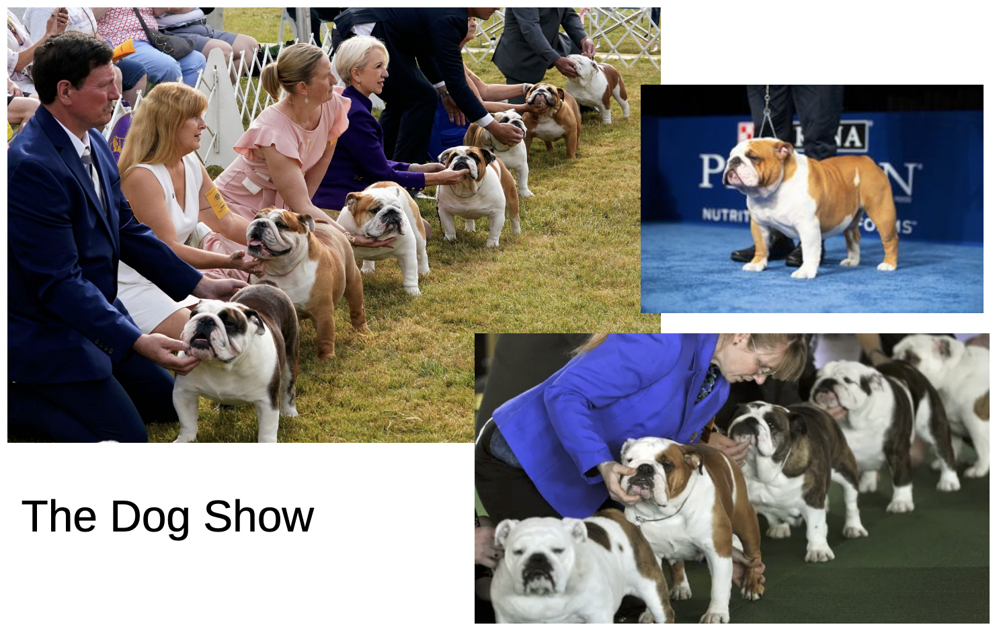{width="100%"}

</center>

::: {.callout icon="true"}
Reference: <a href="https://en.wikipedia.org/wiki/Analysis_of_variance" target="_blank">https://en.wikipedia.org/wiki/Analysis_of_variance</a>
:::

## The Dog Show: Description of Problem

:::{.callout-important icon="true"}
- Imagine that you are hosting a dog show and you want to determine if there are significant differences in the **average weights** of different dog breeds
- For this, you will need specific **characteristics** of the dogs (e.g., breed, weight)
- You will form groups based on the characteristics of the dogs, and then use ANOVA to compare the average weights across these groups.
:::

<center>
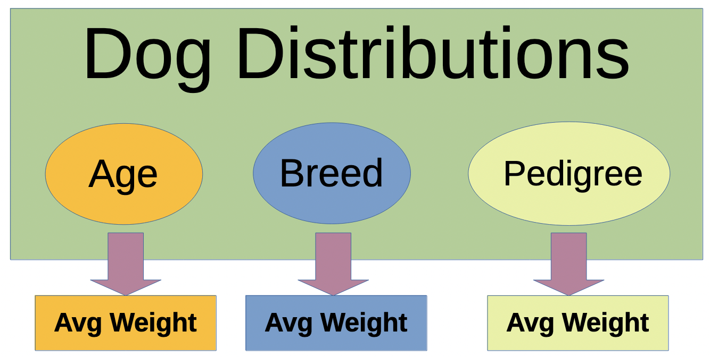{width="50%"}
</center>

::: {style="color: #8E44AD; text-align: center; margin-top: 20px;"}
What are the best ways to arrange groups?!
:::

## The Dog Show: Let's Talk About Grouping The Data

:::{.callout icon="true"}

For Successful group, we have two main requirements:

1. **Homogeneity of Variance:** The variances across groups should be approximately equal.
   - Each group is to be homogeneous or similar by some characteristic.
2. **Distinct means:** The mean of each group is to be different from the others
   - If groups have the same mean, then they are likely not separate in any meaningful way.
::: 

<center>
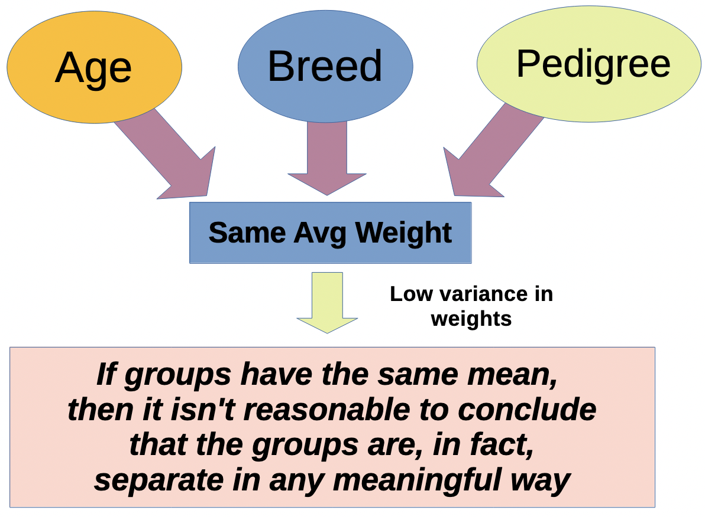{width="50%"}
</center>

## The Dog Show: Bad Group, No Biscuit!


::: {style="color: #da1cc7; text-align: center; margin-top: 90px;"}
What if the groups are not well-defined?
:::


<center>
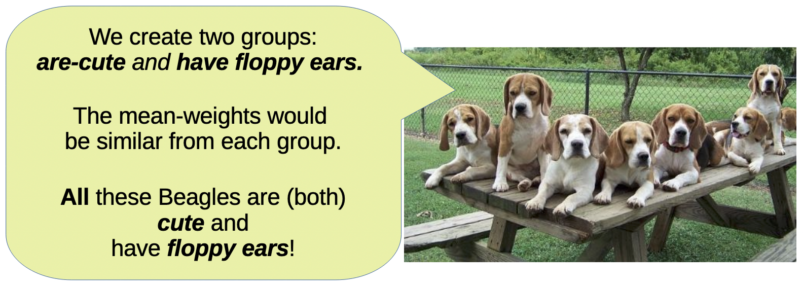
</center>

## The Dog Show: Bad Groups

<center>
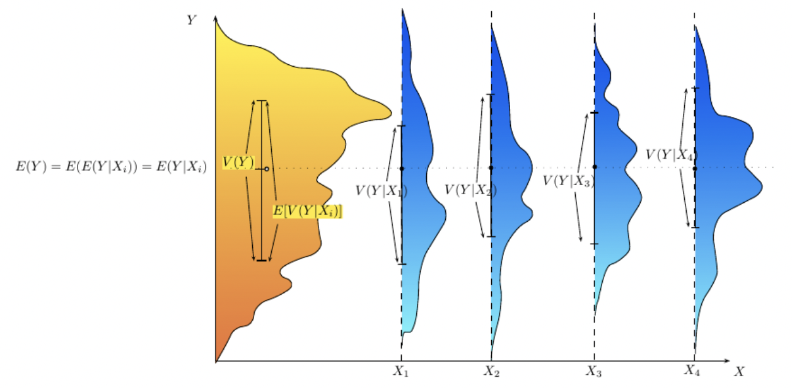{width="60%"}
</center>

::: {style="color: #8E44AD; text-align: center; margin-top: 20px;"}
- Not a fit because all groups are too similar (homogenous). Same mean and same variance.
- Young vs old, and short-haired vs long-haired
- This grouping fails to explain the variation in the overall distribution (yellow-orange)
:::

## The Dog Show: Better Groups

<center>
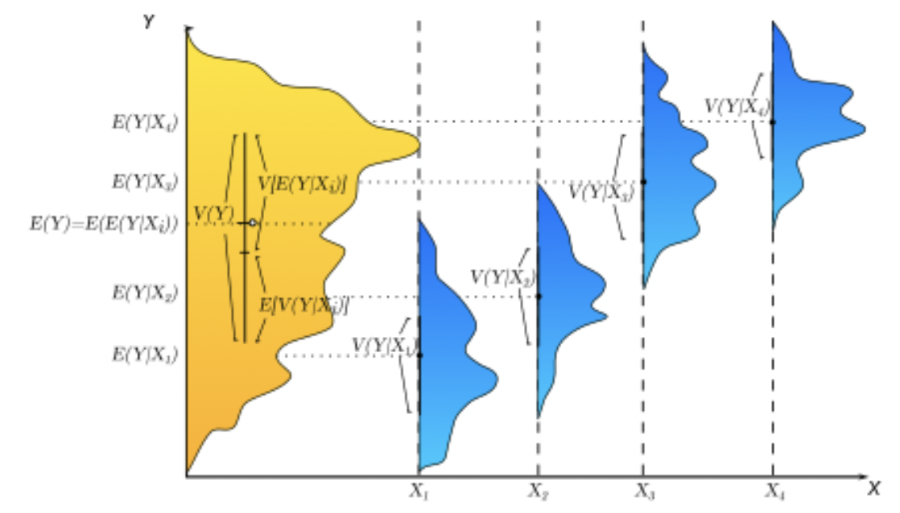{width="60%"}
</center>

::: {style="color: #8E44AD; text-align: center; margin-top: 20px;"}
- A better fit because the groups are distinct and homogeneous. The means are different, and the variances are similar.
- Pet vs Working breed and less athletic vs more athletic
- The significant overlap of distributions causes difficulty in distinguishing between the groups.
:::


## The Dog Show: Best Grouping

<center>
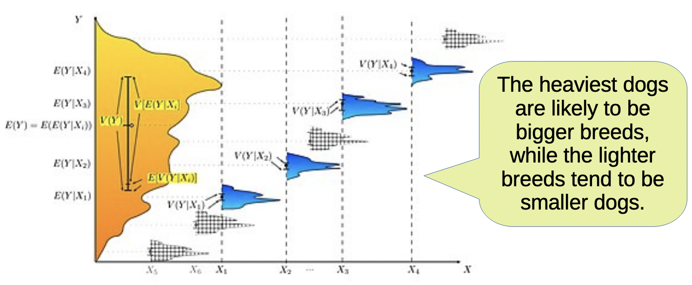{width="80%"}
</center>

::: {style="color: #8E44AD; text-align: center; margin-top: 20px;"}
- A Very good fit because the groups are distinct and homogeneous. The means are different, and the variances are similar.
- Weight by breed
- We can discriminate between groups since the distributions are distinct and homogeneous.
:::


## Good Groupings
```{r characteristics}
#| echo: false
#| fig-width: 11
#| fig-height: 3.2
  # Code to show discrete groupings
  library(tidyverse)
  
  # Create a simple dataset with discrete groups
  data <- tibble(
    group = rep(c("A", "B", "C"), each = 10),
    value = c(rnorm(10, 10, 2), rnorm(10, 15, 2), rnorm(10, 20, 2))
  )
  
  # Plot the data
  ggplot(data, aes(x = group, y = value, fill = group)) +
    geom_boxplot() +
  geom_jitter(width = 0.12, size = 2) +
    scale_x_discrete(
      labels = c("A", "B", "C")) + 
    scale_fill_manual(
      values = c("#3498DB", "#E67E22", "#E63231")) +
  theme_minimal(base_size = 12) +
    theme(legend.position = "none")
  
```

::: {style="color: #8E44AD; text-align: center; margin-top: 20px;"}
Ideal groupings are **distinct** and **homogeneous**
:::


## Dogs Groups Selected From a Population

<center>

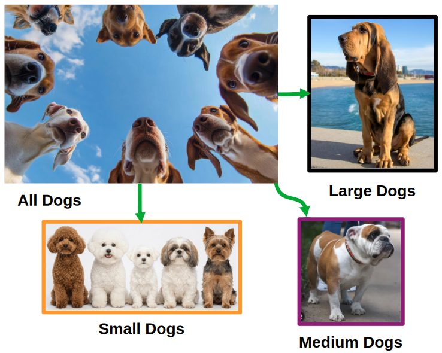{width="55%"}

</center>

::: {.callout}
::: {style="color: #8E44AD; text-align: center; margin-top: 20px;"}
Grouping by dog size: sometimes breeds are not distinct enough to separate the groups. The overlap of distributions causes difficulty in distinguishing the groups.
:::
:::


## So What Test?

<center>

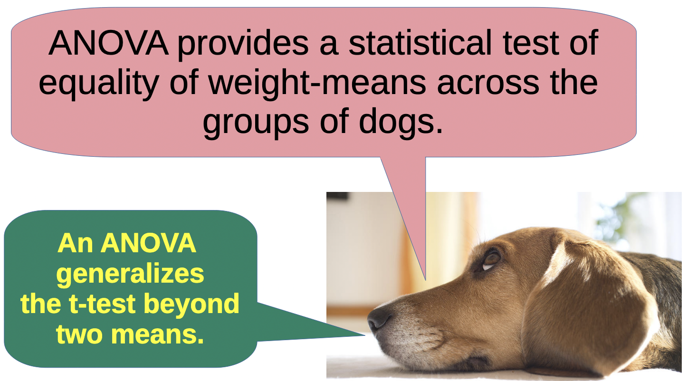{width="50%"}

</center>

:::{.callout-important icon="true"}
**Want to distinguish between the means of three or more groups.** 

- ANOVA is the appropriate test to use in this case. 
- T-tests, works fine for two means, but not more than two means
  - The risks of type error increase with each mean that we are comparing.
  - ANOVA is the appropriate test to use in this case.

:::

---

## One-Way ANOVA: Hypothesis Testing with the Iris data set 🌸

::: {.callout-note icon="false"}
# Hypothesis
**H₀:** all group means are equal.
**H₁:** * at least one mean differs.

ANOVA asks one question with **one** test, holding the error rate at alpha.
:::

:::{.callout-tip icon="true"}
**Tip:** If the p-value is less than the significance level (e.g., 0.05), we reject the null hypothesis and conclude that there is a significant difference between at least two group means.

We cannot tell which mean is different from the others, only that at least one is different. Post-hoc tests are needed to determine which groups differ.
:::


## Let's Hit the Code!


<center>

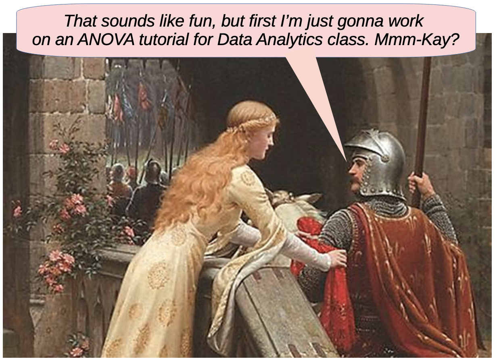{width="80%"}
</center>


## One-Way ANOVA: Run a test

:::{.callout icon="false"}
Question: "Is there a statistically significant difference in the mean sepal length among the three species of iris flowers?""
:::


```{r one-way-anova}
#| echo: true

model <- aov(Sepal.Length ~ Species, data = iris)
summary(model) 
# The model shows that the p-value is less than alpha = 0.01, 
# indicating that there is a statistically significant difference
# in the mean sepal length among the three species of iris flowers.
```

::: {.callout}
**Reading the table:** the F statistic compares variation *between* groups to
variation *within* groups. Big F signifies that the groups are far apart from each other relative to their own
noise. 📏
:::


## A Difference in Means Discovered. Now Where Is It?

:::{.callout-important icon="true"}

The `TukeyHSD(model)` function performs Tukey’s Honestly Significant Difference (HSD) post-hoc test to determine which specific pairs of species differ after conducting an ANOVA.

- Test: Compare the mean sepal lengths of each pair of species: setosa vs. versicolor, setosa vs. virginica, and versicolor vs. virginica.
  - **ANOVA** tells us whether there is a significant difference among the species
  - **Tukey’s** HSD tells us exactly which species differ from one another

The output provides the estimated difference in means, confidence intervals, and adjusted *p*-values for each pair.

In simplest terms: *The ANOVA tells you whether (IF) any species differ in average sepal length, while Tukey’s HSD test tells you which (WHAT ONES) specific species differ from one another.*
:::


## Post-hoc: WHICH Groups Differ? 🔍

:::{.callout icon="false"}
Question: "Which specific pairs of iris species have significantly different mean sepal lengths?"
:::

```{r tukey}
#| echo: true
#| fig-width: 11
#| fig-height: 3.4

tukey <- TukeyHSD(model)
tukey

```


## Reading the Tukey Table

:::{.callout-important icon="true"}
**Interpreting the Tukey Table:**
- The `diff` column shows the difference in means between each pair of groups.
- The `lwr` and `upr` columns show the lower and upper bounds of the 95% confidence interval for each difference.
- The `p adj` column shows the adjusted p-value for multiple comparisons.
:::

:::{.callout}
**How to interpret each comparison**
For example, consider versicolor-setosa.

- diff = 0.930: Versicolor has an average sepal length about 0.93 units greater than setosa.
- lwr = 0.686 and upr = 1.174: The estimated difference is between 0.686 and 1.174 units at the 95% confidence level.
- p adj < 0.05: The difference is statistically significant.
- A useful rule is that if the confidence interval does not include zero, the difference is statistically significant at the corresponding confidence level.
:::


## Pos_hoc: WHICH Groups Differ? (plot)

::: {.callout icon="true"}
Want to ask: "Which pairs of iris species have statistically significant differences in their mean sepal lengths?"
:::

```{r tukey-plot}
#| echo: true
#| fig-width: 11
#| fig-height: 3.4

plot(tukey, las = 1)
```

::: {.callout-important}
Tukey's HSD adjusts for all the pairwise comparisons, so these p-values are
already corrected. Any interval that misses zero is a real difference. ✅
:::


---

## Two-Way ANOVA & Interaction 🔀

```{r two-way-anova}
#| echo: true
#| fig-width: 10
#| fig-height: 3.6
#| output-location: column

data(ToothGrowth)
ToothGrowth$dose <- factor(ToothGrowth$dose)

# The * includes both main effects
# AND their interaction
m2 <- aov(len ~ supp * dose,
          data = ToothGrowth)
summary(m2)

```{r two-way-anova-plot}
#| echo: true
#| fig-width: 10
#| fig-height: 3.6
#| output-location: column
ggplot(ToothGrowth,
       aes(dose, len,
           color = supp,
           group = supp)) +
  stat_summary(fun = mean,
               geom = "line",
               linewidth = 1) +
  stat_summary(fun = mean,
               geom = "point",
               size = 3) +
  labs(title = "Interaction plot",
       subtitle = "Non-parallel lines = interaction") +
  theme_minimal(base_size = 11)
```

---

## ANOVA Diagnostics 🩺

```{r anova-diagnostics}
#| echo: true
#| fig-width: 11
#| fig-height: 4.5

par(mfrow = c(2, 2))
plot(model)
par(mfrow = c(1, 1))
```

::: {.columns}
::: {.column}
**Residuals vs Fitted** — should be a shapeless cloud (equal variance)

**Q-Q Residuals** — points should hug the line (normality)
:::

::: {.column}
**Scale-Location** — flat red line means constant spread

**Residuals vs Leverage** — points past Cook's distance are influential
:::
:::

---

## MANOVA: Several Outcomes at Once 🎭

```{r manova}
#| echo: true

# Do species differ across ALL FOUR flower measurements simultaneously?
m_manova <- manova(cbind(Sepal.Length, Sepal.Width,
                         Petal.Length, Petal.Width) ~ Species,
                   data = iris)
summary(m_manova)

# Then look at each outcome separately
summary.aov(m_manova)[[3]]   # third outcome: Petal.Length
```

::: {.callout-tip}
**Use MANOVA when** your outcomes are correlated and you want one overall test
before drilling down — it controls the error rate across outcomes. 🎯
:::

---

## Interactive: ANOVA Builder 🎮

```{=html}

<!-- Global copy to clipboard function -->
<script>
function copyToClipboard(elementId, buttonElement) {
  const element = document.getElementById(elementId);
  const text = element.textContent;

  navigator.clipboard.writeText(text).then(function() {
    // Visual feedback
    const originalText = buttonElement.innerHTML;
    buttonElement.innerHTML = '✓ Copied!';
    buttonElement.classList.add('copied');

    setTimeout(function() {
      buttonElement.innerHTML = originalText;
      buttonElement.classList.remove('copied');
    }, 2000);
  }).catch(function(err) {
    console.error('Failed to copy:', err);
    buttonElement.innerHTML = '❌ Error';
    setTimeout(function() {
      buttonElement.innerHTML = '📋 Copy';
    }, 2000);
  });
}
</script>

<div class="interactive-tool">
  <h3>📊 ANOVA Builder</h3>

  <div class="tool-controls">
    <div class="control-group">
      <label>Design:</label>
      <select id="av-design">
        <option value="oneway">One-way (1 factor)</option>
        <option value="twoway">Two-way (2 factors)</option>
        <option value="interaction">Two-way with interaction</option>
        <option value="manova">MANOVA (several outcomes)</option>
      </select>
    </div>

    <div class="control-group">
      <label>Dataset:</label>
      <select id="av-data">
        <option value="iris">iris</option>
        <option value="ToothGrowth">ToothGrowth</option>
        <option value="PlantGrowth">PlantGrowth</option>
        <option value="ChickWeight">ChickWeight</option>
      </select>
    </div>

    <div class="control-group">
      <label>Post-hoc test:</label>
      <select id="av-posthoc">
        <option value="tukey">Tukey HSD (all pairs)</option>
        <option value="bonferroni">Pairwise t + Bonferroni</option>
        <option value="holm">Pairwise t + Holm</option>
        <option value="none">None</option>
      </select>
    </div>
  </div>

  <div style="display: grid; grid-template-columns: repeat(3, 1fr); gap: 8px; margin-top: 10px;">
    <label><input type="checkbox" id="av-diag" checked> diagnostic plots</label>
    <label><input type="checkbox" id="av-effect"> effect size (eta squared)</label>
    <label><input type="checkbox" id="av-plot"> group plot</label>
  </div>

  <div class="tool-buttons">
    <button class="tool-button" onclick="generateAnova()">Generate Code</button>
    <button class="tool-button secondary" onclick="clearAnovaTool()">Clear</button>
  </div>

  <div class="tool-output-container">
    <button class="copy-button" onclick="copyToClipboard('av-output', this)">📋 Copy</button>
    <div class="tool-output" id="av-output">Choose a design and click "Generate Code"!</div>
  </div>
</div>

<script>
const avData = {
  iris: {y: 'Sepal.Length', f1: 'Species', f2: null,
         outcomes: 'cbind(Sepal.Length, Sepal.Width, Petal.Length, Petal.Width)'},
  ToothGrowth: {y: 'len', f1: 'supp', f2: 'dose', outcomes: 'cbind(len)'},
  PlantGrowth: {y: 'weight', f1: 'group', f2: null, outcomes: 'cbind(weight)'},
  ChickWeight: {y: 'weight', f1: 'Diet', f2: 'Time', outcomes: 'cbind(weight)'}
};

function generateAnova() {
  const design = document.getElementById('av-design').value;
  const key = document.getElementById('av-data').value;
  const d = avData[key];
  const posthoc = document.getElementById('av-posthoc').value;
  const diag = document.getElementById('av-diag').checked;
  const eff = document.getElementById('av-effect').checked;
  const plot = document.getElementById('av-plot').checked;

  let code = 'library(tidyverse)\ndata(' + key + ')\n\n';

  if (d.f2) {
    code += '# Make sure grouping variables are factors, not numbers!\n';
    code += key + '$' + d.f2 + ' <- factor(' + key + '$' + d.f2 + ')\n\n';
  }

  code += '# --- Step 1: describe the groups -----------------\n';
  code += key + ' %>%\n';
  code += '  group_by(' + d.f1 + (d.f2 && design !== 'oneway' ? ', ' + d.f2 : '') + ') %>%\n';
  code += '  summarize(n = n(), mean = mean(' + d.y + '), sd = sd(' + d.y + '), .groups = "drop")\n\n';

  code += '# --- Step 2: fit the model -----------------------\n';
  if (design === 'manova') {
    code += 'model <- manova(' + d.outcomes + ' ~ ' + d.f1 + ', data = ' + key + ')\n';
    code += 'summary(model)          # overall multivariate test\n';
    code += 'summary.aov(model)      # then each outcome separately\n\n';
    document.getElementById('av-output').textContent = code;
    return;
  } else if (design === 'oneway' || !d.f2) {
    code += 'model <- aov(' + d.y + ' ~ ' + d.f1 + ', data = ' + key + ')\n';
  } else if (design === 'twoway') {
    code += '# + means main effects only (no interaction)\n';
    code += 'model <- aov(' + d.y + ' ~ ' + d.f1 + ' + ' + d.f2 + ', data = ' + key + ')\n';
  } else {
    code += '# * means both main effects AND their interaction\n';
    code += 'model <- aov(' + d.y + ' ~ ' + d.f1 + ' * ' + d.f2 + ', data = ' + key + ')\n';
  }
  code += 'summary(model)\n\n';

  if (eff) {
    code += '# --- Effect size: eta squared --------------------\n';
    code += '# The share of total variation explained by each factor\n';
    code += 'tab <- summary(model)[[1]]\n';
    code += 'eta_sq <- tab[["Sum Sq"]] / sum(tab[["Sum Sq"]])\n';
    code += 'setNames(round(eta_sq, 3), rownames(tab))\n\n';
  }

  if (posthoc !== 'none') {
    code += '# --- Step 3: which groups differ? ----------------\n';
    if (posthoc === 'tukey') {
      code += 'tukey <- TukeyHSD(model)\n';
      code += 'tukey\n';
      code += 'plot(tukey, las = 1)   # intervals that miss 0 are real differences\n\n';
    } else {
      code += 'pairwise.t.test(' + key + '$' + d.y + ', ' + key + '$' + d.f1 + ',\n';
      code += '                p.adjust.method = "' + posthoc + '")\n\n';
      if (posthoc === 'bonferroni') {
        code += '# Bonferroni is simple but conservative;\n';
        code += '# "holm" is uniformly more powerful and just as safe.\n\n';
      }
    }
  }

  if (diag) {
    code += '# --- Step 4: check the assumptions ---------------\n';
    code += 'par(mfrow = c(2, 2))\n';
    code += 'plot(model)     # residuals vs fitted, Q-Q, scale-location, leverage\n';
    code += 'par(mfrow = c(1, 1))\n\n';
    code += '# Formal checks (use the plots as the primary evidence)\n';
    code += 'shapiro.test(residuals(model))          # normality of residuals\n';
    code += 'bartlett.test(' + d.y + ' ~ ' + d.f1 + ', data = ' + key + ')   # equal variances\n\n';
    code += '# If assumptions fail badly -> Kruskal-Wallis \n';
    code += '# kruskal.test(' + d.y + ' ~ ' + d.f1 + ', data = ' + key + ')\n\n';
  }

  if (plot) {
    code += '# --- Step 5: show the groups ---------------------\n';
    code += 'ggplot(' + key + ', aes(x = ' + d.f1 + ', y = ' + d.y + ', fill = ' + d.f1 + ')) +\n';
    code += '  geom_boxplot(alpha = 0.7) +\n';
    code += '  geom_jitter(width = 0.12, alpha = 0.5, size = 1.5) +\n';
    code += '  stat_summary(fun = mean, geom = "point", shape = 23,\n';
    code += '               size = 3, fill = "white") +\n';
    code += '  scale_fill_viridis_d(option = "mako", alpha = 0.7) +\n';
    code += '  labs(title = "' + d.y + ' by ' + d.f1 + '",\n';
    code += '       subtitle = "White diamonds = group means") +\n';
    code += '  theme_minimal() + theme(legend.position = "none")\n';
  }

  document.getElementById('av-output').textContent = code;
}

function clearAnovaTool() {
  ['av-design','av-data','av-posthoc'].forEach(function(id) {
    document.getElementById(id).selectedIndex = 0;
  });
  document.getElementById('av-diag').checked = true;
  document.getElementById('av-effect').checked = false;
  document.getElementById('av-plot').checked = false;
  document.getElementById('av-output').textContent = 'Choose a design and click "Generate Code"!';
}
</script>
```

---

## And Now Onto the Ethics of Testing Responsibly

<center>
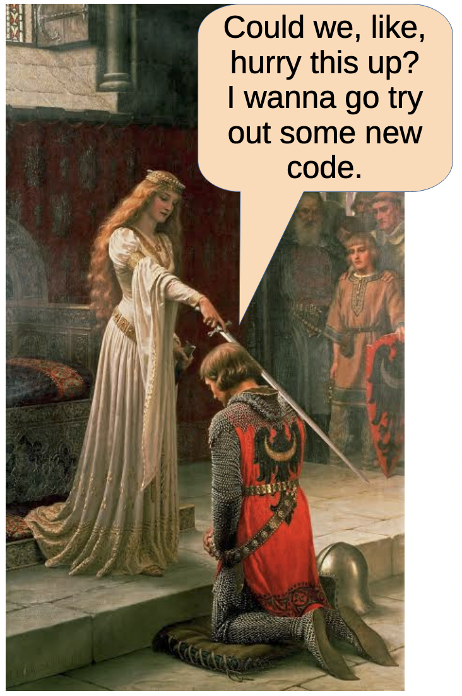{width="40%"}
</center>

## What is P-Hacking?

::: {.callout-warning icon="true"}
## p-hacking: Ways to Manufacture Significance
🚫 Testing many outcomes, reporting the one that worked  
🚫 Adding participants until p < 0.05, then stopping  
🚫 Dropping "outliers" that ruin the result  
🚫 Trying many subgroups (it works for left-handed users under 30!)  
🚫 Switching one-tailed after seeing the direction  
🚫 HARKing — Hypothesizing After Results are Known
:::


:::{.callout-tip icon="true"}
## Tips for Avoiding P-Hacking
- Plan your analysis before collecting data
- Register your study and analysis plan
- Be transparent about your methods and results
- Avoid selectively reporting results
- Use appropriate statistical methods
:::

## Let's See How Easy It Is to P-Hack

```{r p-hacking-demo}
#| echo: true

set.seed(301)
# Test 20 completely random variables against a random outcome
outcome <- rnorm(50)
# generate 20 random variables and compute 
# their p-values against the outcome
ps <- map_dbl(1:20, \(i) cor.test(rnorm(50), outcome)$p.value)

sum(ps < 0.05)          # "discoveries" from pure noise
round(min(ps), 4)       # the one you would be tempted to publish
```

:::{.callout}
**Bad Science**: Reporting only the tests that worked, but they may have been flukes. The other 19 tests were all noise.
:::

---

## Correcting for Multiple Tests 🛡️

```{r p-adjust}
#| echo: true

# Twenty p-values from twenty tests
raw_p <- c(0.001, 0.008, 0.012, 0.03, 0.04, 0.045,
           0.09, 0.11, 0.20, 0.31, 0.44, 0.52,
           0.60, 0.66, 0.71, 0.78, 0.83, 0.88, 0.92, 0.99)

sum(raw_p < 0.05)                                     # num of uncorrected "discoveries"
```

:::{.callout-tip}
When testing 20 hypotheses, there is an increased chance of obtaining false-positive results. Even if every null hypothesis is true, some tests may produce p-values below 0.05 just by chance. So we can correct for multiple comparisons using methods like Bonferroni, Holm, or Benjamini-Hochberg (BH) to control the family-wise error rate or false discovery rate.
:::

## Correcting for Multiple Tests (cont.)

```{r correcting-bonferroni}
sum(p.adjust(raw_p, method = "bonferroni") < 0.05)    # sum of strictest
```

:::{.callout-blue}
**Bonferroni Correction**: This method adjusts the significance level by dividing it by the number of comparisons. It is the most conservative approach, reducing the chance of false positives but also increasing the chance of false negatives.
:::

## Correcting for Multiple Tests (cont.)

```{r corrected-holm}
sum(p.adjust(raw_p, method = "holm") < 0.05)          # sum of better default
```
:::{.callout-blue}
**Holm Correction**: This method is a step-down version of the Bonferroni correction. It is less conservative and more powerful, while still controlling the family-wise error rate.
:::

```{r corrected-bh}
sum(p.adjust(raw_p, method = "BH") < 0.05)            # sum of false discovery rate
```
:::{.callout-blue}
**Benjamini-Hochberg Correction**: This method controls the false discovery rate, which is the expected proportion of false positives among all significant tests. It is less conservative than Bonferroni and Holm, making it more powerful for large-scale multiple testing.
:::


::: {.callout-tip}
**Which to use?** `holm` when every false positive is costly. `BH`
(Benjamini-Hochberg) when you are screening many candidates and can tolerate a
known fraction of false leads. 🎯
:::


## Some References for Further Reading (Part 1)

:::{.callout}
- [P-hacking: A Hidden Threat to Reliable Data Analysis](https://statisticseasily.com/p-hacking/)

- **The Brian Wansink Retractions (The Italian Buffet Case Study)**
  - The Exposure Analysis: Van der Zee, T., Anaya, J., & Brown, N. J. L. (2017). *Statistical heartburn: An attempt to digest four pizza publications from the Cornell Food and Brand Lab. BMC Nutrition*, 3(1).
  - Download Open-Access from ResearchGate: [Statistical heartburn](https://www.researchgate.net/publication/318347412_Statistical_heartburn_An_attempt_to_digest_four_pizza_publications_from_the_Cornell_Food_and_Brand_Lab)
  - The Original P-Hacked Paper: Wansink, B., & Payne, C. R. (2014). *Eating behavior and obesity at Chinese buffets*. Obesity, 22(11), 2307-2312.
    - *Note*: Because this article was formally retracted by the publisher due to systemic data flaws, an authorized open-access PDF of the final version is not legally hosted by major public archives.

- **Daryl Bem’s Precognition Study & The Failed Replications**
  - The Replication Failure: Ritchie, S. J., Wiseman, R., & French, C. C. (2012). *Failing the future: Three unsuccessful attempts to replicate Bem's 'Feeling the Future'*. PLOS ONE, 7(3), e33448.
  - Download Open-Access Publisher PDF via [PLOS ONE](https://journals.plos.org/plosone/article/file?id=10.1371/journal.pone.0033423&type=printable)
  - The Original Paper: Bem, D. J. (2011). *Feeling the future: Experimental evidence for anomalous retroactive influences on cognition and affect*. Journal of Personality and Social Psychology, 100(3), 407–425. (Note: Published by the APA, this document sits behind a paywall; however, a pre-publication version can frequently be found on academic personal repositories).

:::

## Some References for Further Reading (Part 2)

:::{.callout}

- **The "Listening to the Beatles" Satire**
  - The Paper: Simmons, J. P., Nelson, L. D., & Simonsohn, U. (2011). *False-positive psychology: Undisclosed flexibility in data collection and analysis allows presenting anything as significant*. Psychological Science, 22(11), 1359–1366.
  - Download Open-Access PDF via [PubMed](https://pubmed.ncbi.nlm.nih.gov/22006061/)

:::

---

<!-- ## Power & Sample Size Planning 

```{r power-planning}
# Plan BEFORE you collect data, not after
power_grid <- expand_grid(n = seq(10, 200, by = 10),
                          delta = c(2, 5, 10)) %>%
  mutate(power = map2_dbl(n, delta,
                          \(nn, dd) power.t.test(n = nn, delta = dd,
                                                 sd = 15)$power))

ggplot(power_grid, aes(n, power, color = factor(delta))) +
  geom_line(linewidth = 1) +
  geom_hline(yintercept = 0.8, linetype = "dashed") +
  scale_color_manual(values = c("#E74C3C", "#E67E22", "#27AE60")) +
  labs(title = "Power curves (sd = 15, alpha = 0.05)",
       subtitle = "Dashed line = the conventional 80% target",
       color = "True difference", x = "n per group") +
  theme_minimal(base_size = 12)
```

::: {.callout-important}
**Post-hoc power analysis is meaningless.** Power is a property of the *design*,
computed before data collection. 📅
:::

## Power & Sample Size Planning Plot 


```{r power-planning-plot}
#| echo: false
#| fig-width: 10
#| fig-height: 3.6
# Plan BEFORE you collect data, not after
power_grid <- expand_grid(n = seq(10, 200, by = 10),
                          delta = c(2, 5, 10)) %>%
  mutate(power = map2_dbl(n, delta,
                          \(nn, dd) power.t.test(n = nn, delta = dd,
                                                 sd = 15)$power))

ggplot(power_grid, aes(n, power, color = factor(delta))) +
  geom_line(linewidth = 1) +
  geom_hline(yintercept = 0.8, linetype = "dashed") +
  scale_color_manual(values = c("#E74C3C", "#E67E22", "#27AE60")) +
  labs(title = "Power curves (sd = 15, alpha = 0.05)",
       subtitle = "Dashed line = the conventional 80% target",
       color = "True difference", x = "n per group") +
  theme_minimal(base_size = 12)
```


--- -->

## Which Test Do I Need? 🗺️

:::{.callout-note icon="true"}
| Situation | Test | R function |
|:--|:--|:--|
| One mean vs a value | One-sample t | `t.test(x, mu = )` |
| Two independent means | Welch t | `t.test(y ~ g)` |
| Two paired means | Paired t | `t.test(before, after, paired = TRUE)` |
| 3+ means, one factor | One-way ANOVA | `aov(y ~ g)` |
| 3+ means, two factors | Two-way ANOVA | `aov(y ~ a * b)` |
| Several outcomes at once | MANOVA | `manova(cbind(...) ~ g)` |
| Which pairs differ | Tukey HSD | `TukeyHSD(model)` |
<!-- | Assumptions broken | **Week 10!** | `wilcox.test()`, `kruskal.test()` | -->
:::

---

## Interactive: p-value Simulator 🎮

```{=html}
<div class="interactive-tool">
  <h3>🎲 p-value & Power Simulator</h3>

  <div class="tool-controls">
    <div class="control-group">
      <label>Simulate:</label>
      <select id="pv-mode">
        <option value="null">H0 is TRUE (no real effect)</option>
        <option value="effect">H1 is TRUE (a real effect exists)</option>
        <option value="phack">p-hacking: test many outcomes</option>
        <option value="optional">Optional stopping (peeking at the data)</option>
      </select>
    </div>

    <div class="control-group">
      <label>Sample size per group:</label>
      <select id="pv-n">
        <option value="10">10</option>
        <option value="30">30</option>
        <option value="100">100</option>
      </select>
    </div>

    <div class="control-group">
      <label>True effect (in SD units):</label>
      <select id="pv-delta">
        <option value="0">0.0 (nothing)</option>
        <option value="0.2">0.2 (small)</option>
        <option value="0.5">0.5 (medium)</option>
        <option value="0.8">0.8 (large)</option>
      </select>
    </div>
  </div>

  <div class="tool-buttons">
    <button class="tool-button" onclick="generatePvalueSim()">Generate Simulation</button>
    <button class="tool-button secondary" onclick="clearPvTool()">Clear</button>
  </div>

  <div class="tool-output-container">
    <button class="copy-button" onclick="copyToClipboard('pv-output', this)">📋 Copy</button>
    <div class="tool-output" id="pv-output">Pick a scenario and click "Generate Simulation"!</div>
  </div>
</div>

<script>
function generatePvalueSim() {
  const mode = document.getElementById('pv-mode').value;
  const n = document.getElementById('pv-n').value;
  const delta = document.getElementById('pv-delta').value;

  let code = 'library(tidyverse)\nset.seed(301)\n\n';

  if (mode === 'null') {
    code += '# --- What p-values look like when NOTHING is real ---\n';
    code += 'ps <- replicate(5000, {\n';
    code += '  a <- rnorm(' + n + ', 100, 15)\n';
    code += '  b <- rnorm(' + n + ', 100, 15)   # same population!\n';
    code += '  t.test(a, b)$p.value\n';
    code += '})\n\n';
    code += 'mean(ps < 0.05)   # should be about 0.05 - that IS alpha\n\n';
    code += 'ggplot(tibble(p = ps), aes(p)) +\n';
    code += '  geom_histogram(binwidth = 0.05, boundary = 0,\n';
    code += '                 fill = "#BDC3C7", color = "white") +\n';
    code += '  geom_vline(xintercept = 0.05, color = "#E74C3C") +\n';
    code += '  labs(title = "Under H0, p-values are UNIFORM",\n';
    code += '       subtitle = "Every value is equally likely - including 0.01") +\n';
    code += '  theme_minimal()\n\n';
    code += '# This is the key insight: a small p-value is not rare evidence,\n';
    code += '# it is exactly as likely as any other value when H0 is true.\n';
  } else if (mode === 'effect') {
    code += '# --- Power: how often do we catch a real effect? ---\n';
    code += 'delta_sd <- ' + delta + '   # true difference in SD units\n\n';
    code += 'ps <- replicate(5000, {\n';
    code += '  a <- rnorm(' + n + ', 100, 15)\n';
    code += '  b <- rnorm(' + n + ', 100 + delta_sd * 15, 15)\n';
    code += '  t.test(a, b)$p.value\n';
    code += '})\n\n';
    code += 'mean(ps < 0.05)   # simulated power\n';
    code += 'power.t.test(n = ' + n + ', delta = delta_sd * 15, sd = 15)$power  # theory\n\n';
    code += '# The exaggeration problem: among the studies that "worked",\n';
    code += '# how big did the effect look?\n';
    code += 'results <- map_dfr(1:2000, function(i) {\n';
    code += '  a <- rnorm(' + n + ', 100, 15)\n';
    code += '  b <- rnorm(' + n + ', 100 + delta_sd * 15, 15)\n';
    code += '  tt <- t.test(a, b)\n';
    code += '  tibble(p = tt$p.value, est = mean(b) - mean(a))\n';
    code += '})\n\n';
    code += 'results %>%\n';
    code += '  group_by(significant = p < 0.05) %>%\n';
    code += '  summarize(mean_estimate = mean(est), truth = delta_sd * 15)\n';
    code += '# Significant studies OVERESTIMATE the effect. This is why\n';
    code += '# published effects shrink when replicated. 📉\n';
  } else if (mode === 'phack') {
    code += '# --- p-hacking by testing many outcomes ------------\n';
    code += 'n_outcomes <- 20\n\n';
    code += 'one_study <- function() {\n';
    code += '  group <- rep(c("A", "B"), each = ' + n + ')\n';
    code += '  # 20 outcomes, all pure noise\n';
    code += '  ps <- map_dbl(1:n_outcomes, \\(i) {\n';
    code += '    y <- rnorm(2 * ' + n + ')\n';
    code += '    t.test(y ~ group)$p.value\n';
    code += '  })\n';
    code += '  min(ps)   # the researcher reports only the best one\n';
    code += '}\n\n';
    code += 'best_ps <- replicate(1000, one_study())\n\n';
    code += 'mean(best_ps < 0.05)\n';
    code += '# The advertised error rate is 5%. The real one is ~64%.\n\n';
    code += '# The fix: correct for the number of tests\n';
    code += 'mean(p.adjust(best_ps, method = "bonferroni") < 0.05)\n';
  } else {
    code += '# --- Optional stopping: peeking as data arrives ----\n';
    code += 'peek_until_significant <- function(max_n = 200) {\n';
    code += '  a <- rnorm(max_n, 100, 15)\n';
    code += '  b <- rnorm(max_n, 100, 15)     # NO real difference\n';
    code += '  for (i in seq(10, max_n, by = 5)) {\n';
    code += '    if (t.test(a[1:i], b[1:i])$p.value < 0.05) return(TRUE)\n';
    code += '  }\n';
    code += '  FALSE\n';
    code += '}\n\n';
    code += 'mean(replicate(500, peek_until_significant()))\n';
    code += '# Roughly 25-30% false positives instead of 5%,\n';
    code += '# from a study where nothing is happening at all.\n\n';
    code += '# The fix: decide n in advance (power analysis), or use\n';
    code += '# a sequential design with corrected boundaries.\n';
  }

  document.getElementById('pv-output').textContent = code;
}

function clearPvTool() {
  ['pv-mode','pv-n','pv-delta'].forEach(function(id) {
    document.getElementById(id).selectedIndex = 0;
  });
  document.getElementById('pv-output').textContent =
    'Pick a scenario and click "Generate Simulation"!';
}
</script>
```

---

## Knowledge Check 🧠

```{=html}
<div class="quiz-box">
  <div class="quiz-question">
    An ANOVA gives p = 0.002 across four groups. What can you conclude?
  </div>

  <div class="quiz-options">
    <div class="quiz-option" onclick="checkTestQuiz2(this, false)">All four group means differ from each other</div>
    <div class="quiz-option" onclick="checkTestQuiz2(this, true)">At least one group differs — a post-hoc test is needed to say which</div>
    <div class="quiz-option" onclick="checkTestQuiz2(this, false)">The largest and smallest groups differ, and the middle two do not</div>
    <div class="quiz-option" onclick="checkTestQuiz2(this, false)">The differences are large and practically important</div>
  </div>

  <div id="test-quiz2-feedback" style="display: none;"></div>
</div>

<script>
function checkTestQuiz2(element, isCorrect) {
  const box = element.closest('.quiz-box');
  box.querySelectorAll('.quiz-option').forEach(function(opt) {
    opt.classList.remove('correct', 'incorrect');
  });
  element.classList.add(isCorrect ? 'correct' : 'incorrect');
  const feedback = document.getElementById('test-quiz2-feedback');
  feedback.style.display = 'block';
  feedback.className = 'quiz-feedback ' + (isCorrect ? 'correct' : 'incorrect');
  if (isCorrect) {
    feedback.textContent = '✅ Correct! ANOVA is an omnibus test — it detects that something is different without saying what. TukeyHSD() answers the follow-up while controlling the error rate.';
  } else {
    feedback.textContent = '❌ Not quite! The ANOVA null is "all means equal". Rejecting it only means that claim fails — not which pair caused it. And p never speaks to importance.';
  }
}
</script>
```

---

# Quick Challenges! 🧠

## Challenge 1: Choosing the Test

```{=html}
<div class="quiz-box">
  <div class="quiz-question">
    You measure blood pressure in 40 patients before and after a 6-week program.
    Which test?
  </div>

  <div class="quiz-options">
    <div class="quiz-option" onclick="checkChallenge1(this, false)">Two-sample t-test on the 80 measurements</div>
    <div class="quiz-option" onclick="checkChallenge1(this, true)">Paired t-test — each patient is their own control</div>
    <div class="quiz-option" onclick="checkChallenge1(this, false)">One-way ANOVA with 40 groups</div>
    <div class="quiz-option" onclick="checkChallenge1(this, false)">One-sample t-test on the "after" values</div>
  </div>

  <div id="challenge1-feedback" style="display: none;"></div>
</div>

<script>
function checkChallenge1(element, isCorrect) {
  const box = element.closest('.quiz-box');
  box.querySelectorAll('.quiz-option').forEach(function(opt) {
    opt.classList.remove('correct', 'incorrect');
  });
  element.classList.add(isCorrect ? 'correct' : 'incorrect');
  const feedback = document.getElementById('challenge1-feedback');
  feedback.style.display = 'block';
  feedback.className = 'quiz-feedback ' + (isCorrect ? 'correct' : 'incorrect');
  if (isCorrect) {
    feedback.textContent = '✅ Correct! Measurements from the same person are not independent. Pairing removes between-person variation and is far more powerful. (Design caution: with no control group, you cannot separate the program from natural change.)';
  } else {
    feedback.textContent = '❌ Not quite! Are the 80 measurements independent? The same 40 people appear twice.';
  }
}
</script>
```

---

## Challenge 2: The Significance Trap

```{=html}
<div class="quiz-box">
  <div class="quiz-question">
    Study A (n = 20) reports p = 0.06; Study B (n = 5000) reports p = 0.001.
    Both estimate the same 0.3-point difference. What is the best reading?
  </div>

  <div class="quiz-options">
    <div class="quiz-option" onclick="checkChallenge2(this, false)">Study B found a real effect; Study A found nothing</div>
    <div class="quiz-option" onclick="checkChallenge2(this, false)">Study B's effect is 60 times stronger</div>
    <div class="quiz-option" onclick="checkChallenge2(this, true)">Both estimate the same small effect — B just had the precision to resolve it, and 0.3 points may not matter either way</div>
    <div class="quiz-option" onclick="checkChallenge2(this, false)">Study A should be rerun until it reaches significance</div>
  </div>

  <div id="challenge2-feedback" style="display: none;"></div>
</div>

<script>
function checkChallenge2(element, isCorrect) {
  const box = element.closest('.quiz-box');
  box.querySelectorAll('.quiz-option').forEach(function(opt) {
    opt.classList.remove('correct', 'incorrect');
  });
  element.classList.add(isCorrect ? 'correct' : 'incorrect');
  const feedback = document.getElementById('challenge2-feedback');
  feedback.style.display = 'block';
  feedback.className = 'quiz-feedback ' + (isCorrect ? 'correct' : 'incorrect');
  if (isCorrect) {
    feedback.textContent = '✅ Correct! p mixes effect size with sample size. With enough data, any nonzero difference becomes significant. Ask "how big, and does it matter?" before "is it significant?" (And rerunning until p < 0.05 is p-hacking.)';
  } else {
    feedback.textContent = '❌ Not quite! Both studies estimated the SAME difference. What else, besides effect size, drives a p-value down?';
  }
}
</script>
```

---

## Challenge 3: Assumptions

```{=html}
<div class="quiz-box">
  <div class="quiz-question">
    Which assumption violation is <strong>least</strong> fixable by a bigger sample?
  </div>

  <div class="quiz-options">
    <div class="quiz-option" onclick="checkChallenge3(this, false)">Non-normal data</div>
    <div class="quiz-option" onclick="checkChallenge3(this, false)">Unequal variances between groups</div>
    <div class="quiz-option" onclick="checkChallenge3(this, true)">Non-independent observations (e.g. students clustered in classrooms)</div>
    <div class="quiz-option" onclick="checkChallenge3(this, false)">Small expected cell counts</div>
  </div>

  <div id="challenge3-feedback" style="display: none;"></div>
</div>

<script>
function checkChallenge3(element, isCorrect) {
  const box = element.closest('.quiz-box');
  box.querySelectorAll('.quiz-option').forEach(function(opt) {
    opt.classList.remove('correct', 'incorrect');
  });
  element.classList.add(isCorrect ? 'correct' : 'incorrect');
  const feedback = document.getElementById('challenge3-feedback');
  feedback.style.display = 'block';
  feedback.className = 'quiz-feedback ' + (isCorrect ? 'correct' : 'incorrect');
  if (isCorrect) {
    feedback.textContent = '✅ Correct! The CLT rescues you from non-normality, and Welch handles unequal variances. Dependence just gets worse with more data — your effective sample size is the number of clusters, not people. It needs a different MODEL (mixed effects), not more rows.';
  } else {
    feedback.textContent = '❌ Not quite! Which of these does the Central Limit Theorem NOT help with, no matter how much data you collect?';
  }
}
</script>
```

---

## Challenge 4: Write the Code

```{=html}
<div class="quiz-box">
  <div class="quiz-question">
    <strong>Write code</strong> that tests whether the three <code>PlantGrowth</code>
    treatment groups differ in weight: check the assumptions, run the ANOVA, and
    if it is significant, find which pairs differ.
    <button class="tool-button" onclick="showChallenge4Solution(this)" style="margin-top: 10px;">Show Solution</button>
  </div>

  <div id="challenge4-solution" style="display: none; margin-top: 15px;">
    <div class="quiz-feedback correct">
      <strong>Solution:</strong><br>
      <code style="display: block; background: #f5f5f5; padding: 10px; margin-top: 8px; border-radius: 4px;">
library(tidyverse)<br>
data(PlantGrowth)<br>
<br>
# 1. Describe first — always<br>
PlantGrowth |&gt;<br>
&nbsp;&nbsp;group_by(group) |&gt;<br>
&nbsp;&nbsp;summarize(n = n(), mean = mean(weight), sd = sd(weight))<br>
<br>
# 2. Fit the model<br>
model &lt;- aov(weight ~ group, data = PlantGrowth)<br>
summary(model)<br>
<br>
# 3. Check assumptions on the FITTED model<br>
par(mfrow = c(2, 2)); plot(model); par(mfrow = c(1, 1))<br>
shapiro.test(residuals(model))<br>
bartlett.test(weight ~ group, data = PlantGrowth)<br>
<br>
# 4. Post-hoc only if the omnibus test is significant<br>
TukeyHSD(model)<br>
<br>
# 5. Effect size: how much variation does group explain?<br>
tab &lt;- summary(model)[[1]]<br>
tab[["Sum Sq"]][1] / sum(tab[["Sum Sq"]])&nbsp;&nbsp;# eta squared<br>
<br>
# Result: the ANOVA is significant (p ≈ 0.016), but the only<br>
# clearly separated pair is trt2 vs trt1 (adjusted p ≈ 0.012).<br>
# trt2 vs ctrl does NOT clear the bar once Tukey adjusts.
      </code>
    </div>
  </div>
</div>

<script>
function showChallenge4Solution(btn) {
  document.getElementById('challenge4-solution').style.display = 'block';
  btn.textContent = '✓ Solution Shown';
  btn.disabled = true;
}
</script>
```

---


# Quick Reference

:::{.callout-blue}


| Task | Code |
|:-----|:-----|
| One-sample t | `t.test(x, mu = 0)` |
| Two-sample (Welch) | `t.test(y ~ g, data = df)` |
| Paired t | `t.test(x, y, paired = TRUE)` |
| One-sided | `alternative = "greater"` |
| One-way ANOVA | `aov(y ~ g, data = df)` |
| Two-way + interaction | `aov(y ~ a * b, data = df)` |
| MANOVA | `manova(cbind(y1, y2) ~ g)` |
| Post-hoc | `TukeyHSD(model)` |
| Pairwise + correction | `pairwise.t.test(y, g, p.adjust.method = "holm")` |
| Adjust p-values | `p.adjust(ps, method = "BH")` |
| Normality | `shapiro.test()`, Q-Q plot |
| Equal variance | `var.test()`, `bartlett.test()` |
| Diagnostics | `plot(model)` |
| Power / sample size | `power.t.test()`, `power.anova.test()` |
:::

---

<!-- # Resources 📚

**Documentation:**

- [R stats package reference](https://stat.ethz.ch/R-manual/R-devel/library/stats/html/00Index.html)
- [broom](https://broom.tidymodels.org/) — turn test output into tidy data frames

**Essential Reading:**

- [The ASA Statement on p-values](https://doi.org/10.1080/00031305.2016.1154108)
- Reinhart, *Statistics Done Wrong* — [free online](https://www.statisticsdonewrong.com/)
- Gelman & Loken, "The Garden of Forking Paths"

**Practice:**

- Before your next test, write down H₀, α, and n — **in advance**. 📝

--- -->

<!-- # What's Next? 

::: {style="text-align: center; font-size: 1.2em; color: #27AE60; margin-top: 40px;"}
**You can now test a hypothesis — and question one.** 🔬

Design → assumptions → test → effect size → honest reporting

::: {style="font-size: 0.85em; color: #8E44AD; margin-top: 25px;"}
**Next week:** What to do when the assumptions fail — rank-based tests,
chi-square, and the bootstrap. 🃏
:::
::: -->
