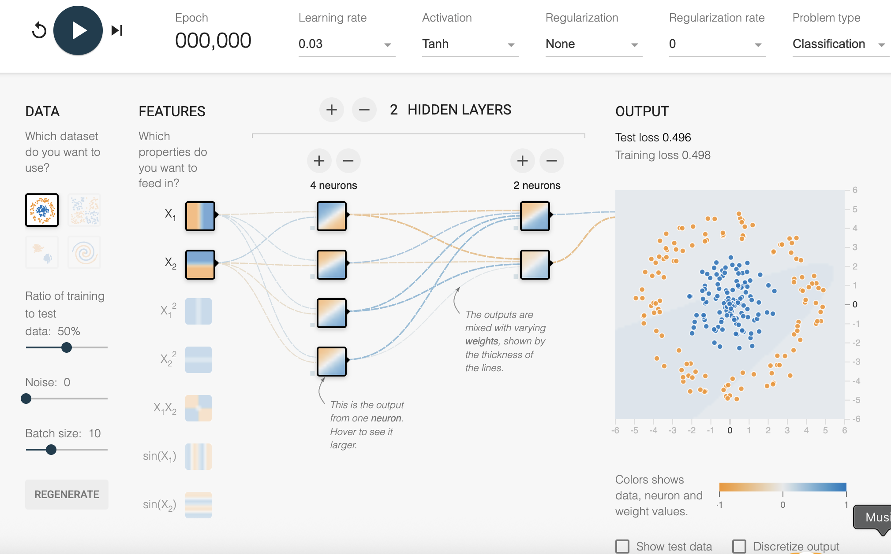
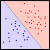
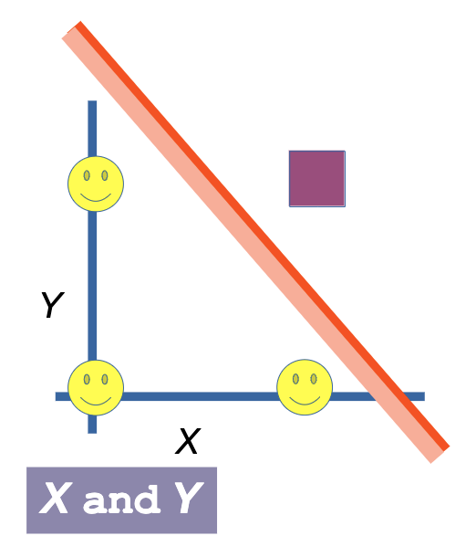
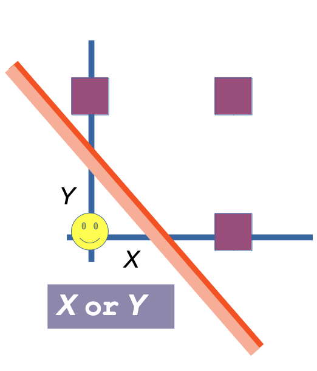
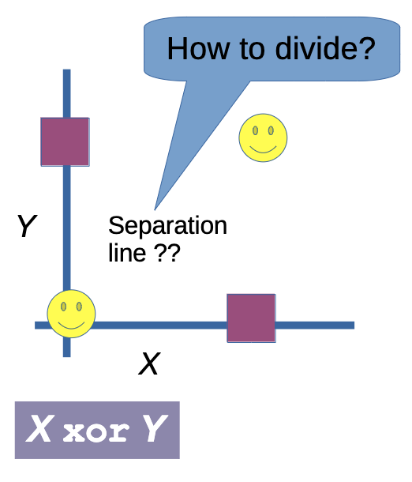

<!-- ::: {style="color: #8E44AD; text-align: center; margin-top: 20px;"}
**Required R Code and Packages**
::: -->

# Hey, Looking for More Classes Next Semester?

<center>

</center>

<center>
CMPSC-405
</center>

## 🛣 Deep Learning (CMPSC-405)

::: {.callout-important}
An interrogation of foundational capabilities, challenges and consequences of deep learning algorithms. Participating in hands-on activities that often require teamwork, students master theoretical concepts to build and train neural network architectures and learn how to improve them. Leveraging insights and tools from an industry partner, students also investigate real-world cases such as speech recognition, machine translation, computer vision, and natural language processing. During a weekly laboratory session students use advanced operating systems software to complete projects, reporting on their results through both written documents and oral presentations. Students are invited to use their own departmentally approved laptop in this course; a limited number of laptops are available for use during class and lab sessions. Prerequisite: CMPSC 301. Distribution Requirements: QR, SP.

Requisites:
Take CMPSC*301 - Must be completed prior to taking this course.
:::

## What Would I Learn?

<center>

</center>

<center>
Neural Networks!
</center>

# Learning Objectives {.smaller}

By the end of this presentation, you will:

- 🧠 Understand what neural networks are and how they work
- 🎯 Learn the basic architecture: neurons, layers, and activation functions
- 🔧 Build your own neural networks in **R** using `neuralnet` and `nnet`
- 🐍 Build equivalent neural networks in **Python** using `keras` and `scikit-learn`
- 📊 Visualize network architecture and training progress
- 🚀 Apply neural networks to real-world classification problems
- 📈 Interpret outputs, weights, and training metrics

::: {.callout-note}
## What You'll Need 
**R:** RStudio with `neuralnet`, `nnet`, and `tidyverse` packages  
**Python:** Python 3.x with `tensorflow`, `keras`, `scikit-learn`, and `matplotlib`
:::

# What is a Neural Network? {.smaller}

::: {.columns}
::: {.column width="50%"}
**Inspired by the Human Brain!** 🧬

- Networks of interconnected **neurons** (nodes)
- Each connection has a **weight** (strength)
- Neurons apply **activation functions**
- Learn by adjusting weights based on errors

**Real-life Analogy:**
"Learning to recognize a cat" 🐱

- Input: Image pixels
- Hidden layers: Detect edges → shapes → features
- Output: "Cat" or "Not Cat"
:::

::: {.column width="50%"}
**Neural Network Structure:**

```
    Input Layer
      /  |  \
     •   •   •
      \ | /  |
   Hidden Layer
      / | \
     •  •  •
      \ | /
   Output Layer
       •
```

**Key Components:**

- 🔵 **Input Layer**: Receives features
- 🟣 **Hidden Layers**: Process information
- 🟢 **Output Layer**: Makes predictions
- ⚡ **Weights**: Connection strengths
- 🎯 **Activation Functions**: Non-linear transformations
:::
:::

## Interactive Demo {.smaller}

**Adjust the inputs and watch how the neural network processes information:**

```{=html}
<div id="nn-interactive" style="margin: 20px auto; max-width: 900px;">
  <div style="display: flex; gap: 20px; margin-bottom: 20px;">
    <div style="flex: 1;">
      <label style="display: block; margin-bottom: 5px; font-weight: bold;">Input 1: <span id="nn-input1-val">0.5</span></label>
      <input type="range" id="nn-input1" min="0" max="100" value="50" style="width: 100%;">
    </div>
    <div style="flex: 1;">
      <label style="display: block; margin-bottom: 5px; font-weight: bold;">Input 2: <span id="nn-input2-val">0.5</span></label>
      <input type="range" id="nn-input2" min="0" max="100" value="50" style="width: 100%;">
    </div>
  </div>
  <canvas id="nnCanvas" width="800" height="350" style="border: 2px solid #ccc; border-radius: 8px; background: white; display: block; margin: 0 auto;"></canvas>
  <div style="margin-top: 10px; padding: 10px; background: #f0f0f0; border-radius: 8px; text-align: center;">
    <strong>Output: <span id="output-val" style="font-size: 1.2em; color: #2E86AB;">0.50</span></strong>
  </div>
</div>

<script>
(function() {
  const canvas = document.getElementById('nnCanvas');
  if (!canvas) return;
  
  const ctx = canvas.getContext('2d');
  const input1Slider = document.getElementById('nn-input1');
  const input2Slider = document.getElementById('nn-input2');
  const input1Val = document.getElementById('nn-input1-val');
  const input2Val = document.getElementById('nn-input2-val');
  const outputVal = document.getElementById('output-val');
  
  // Network structure
  const layers = {
    input: [{x: 100, y: 125}, {x: 100, y: 225}],
    hidden: [{x: 350, y: 75}, {x: 350, y: 175}, {x: 350, y: 275}],
    output: [{x: 600, y: 175}]
  };
  
  // Weights (designed for demo visibility)
  const weights = {
    inputToHidden: [
      [2.5, -1.8, 1.2],  // input1 to hidden neurons
      [-1.5, 2.8, 2.0]   // input2 to hidden neurons
    ],
    hiddenToOutput: [1.5, -1.2, 2.0]  // hidden to output
  };
  
  // Activation function (sigmoid)
  function sigmoid(x) {
    return 1 / (1 + Math.exp(-x));
  }
  
  function drawNetwork() {
    ctx.clearRect(0, 0, canvas.width, canvas.height);
    
    // Get input values
    const i1 = parseFloat(input1Slider.value) / 100;
    const i2 = parseFloat(input2Slider.value) / 100;
    
    // Debug logging (can remove later)
    console.log('Input 1:', i1, 'Input 2:', i2);
    
    // Update display
    input1Val.textContent = i1.toFixed(2);
    input2Val.textContent = i2.toFixed(2);
    
    // Calculate hidden layer activations
    const hidden = [];
    for (let h = 0; h < 3; h++) {
      const sum = i1 * weights.inputToHidden[0][h] + i2 * weights.inputToHidden[1][h];
      hidden[h] = sigmoid(sum);
    }
    
    console.log('Hidden activations:', hidden);
    
    // Calculate output
    let outputSum = 0;
    for (let h = 0; h < 3; h++) {
      outputSum += hidden[h] * weights.hiddenToOutput[h];
    }
    const output = sigmoid(outputSum);
    
    console.log('Output sum:', outputSum, 'Final output:', output);
    
    outputVal.textContent = output.toFixed(2);
    
    // Draw connections from input to hidden
    for (let i = 0; i < 2; i++) {
      for (let h = 0; h < 3; h++) {
        const weight = weights.inputToHidden[i][h];
        const alpha = Math.min(Math.abs(weight), 1);
        ctx.strokeStyle = weight > 0 ? `rgba(46, 134, 171, ${alpha})` : `rgba(255, 107, 107, ${alpha})`;
        ctx.lineWidth = Math.abs(weight) * 3;
        ctx.beginPath();
        ctx.moveTo(layers.input[i].x + 25, layers.input[i].y);
        ctx.lineTo(layers.hidden[h].x - 25, layers.hidden[h].y);
        ctx.stroke();
      }
    }
    
    // Draw connections from hidden to output
    for (let h = 0; h < 3; h++) {
      const weight = weights.hiddenToOutput[h];
      const alpha = Math.min(Math.abs(weight), 1);
      ctx.strokeStyle = weight > 0 ? `rgba(46, 134, 171, ${alpha})` : `rgba(255, 107, 107, ${alpha})`;
      ctx.lineWidth = Math.abs(weight) * 3;
      ctx.beginPath();
      ctx.moveTo(layers.hidden[h].x + 25, layers.hidden[h].y);
      ctx.lineTo(layers.output[0].x - 25, layers.output[0].y);
      ctx.stroke();
    }
    
    // Draw input neurons
    drawNeuron(layers.input[0].x, layers.input[0].y, i1, 'Input 1');
    drawNeuron(layers.input[1].x, layers.input[1].y, i2, 'Input 2');
    
    // Draw hidden neurons
    hidden.forEach((activation, idx) => {
      drawNeuron(layers.hidden[idx].x, layers.hidden[idx].y, activation, `H${idx + 1}`);
    });
    
    // Draw output neuron
    drawNeuron(layers.output[0].x, layers.output[0].y, output, 'Output');
  }
  
  function drawNeuron(x, y, activation, label) {
    const radius = 25;
    
    // Draw neuron circle with activation-based color
    // Vibrant color gradient: Blue (low) -> Cyan -> Green -> Yellow -> Orange -> Red (high)
    let r, g, b;
    if (activation < 0.2) {
      // Deep blue to cyan
      const t = activation / 0.2;
      r = Math.floor(30 + t * 30);
      g = Math.floor(100 + t * 155);
      b = 255;
    } else if (activation < 0.4) {
      // Cyan to green
      const t = (activation - 0.2) / 0.2;
      r = Math.floor(60 - t * 30);
      g = 255;
      b = Math.floor(255 - t * 155);
    } else if (activation < 0.6) {
      // Green to yellow
      const t = (activation - 0.4) / 0.2;
      r = Math.floor(30 + t * 225);
      g = 255;
      b = Math.floor(100 - t * 100);
    } else if (activation < 0.8) {
      // Yellow to orange
      const t = (activation - 0.6) / 0.2;
      r = 255;
      g = Math.floor(255 - t * 90);
      b = 0;
    } else {
      // Orange to red
      const t = (activation - 0.8) / 0.2;
      r = 255;
      g = Math.floor(165 - t * 165);
      b = Math.floor(t * 50);
    }
    
    ctx.fillStyle = `rgb(${r}, ${g}, ${b})`;
    ctx.strokeStyle = '#333';
    ctx.lineWidth = 2;
    ctx.beginPath();
    ctx.arc(x, y, radius, 0, 2 * Math.PI);
    ctx.fill();
    ctx.stroke();
    
    // Draw label with adaptive text color
    // Use black text for light colors (cyan, green, yellow), white for dark colors (blue, red, orange)
    const textColor = (activation >= 0.2 && activation <= 0.7) ? '#000' : '#fff';
    ctx.fillStyle = textColor;
    ctx.font = 'bold 12px Arial';
    ctx.textAlign = 'center';
    ctx.textBaseline = 'middle';
    ctx.fillText(label, x, y - 8);
    
    // Draw activation value
    ctx.font = '10px Arial';
    ctx.fillText(activation.toFixed(2), x, y + 8);
  }
  
  // Event listeners - use both input and change for better compatibility
  if (input1Slider && input2Slider) {
    input1Slider.addEventListener('input', drawNetwork);
    input1Slider.addEventListener('change', drawNetwork);
    input2Slider.addEventListener('input', drawNetwork);
    input2Slider.addEventListener('change', drawNetwork);
  }
  
  // Initial draw
  drawNetwork();
})();
</script>
```

::: {style="font-size: 0.9em;"}
::: {.callout-tip}
## Try This!
Move the sliders to see how different inputs affect the network's output. Notice how:
- **Node colors** represent activation levels (blue = low, red = high)
- **Line thickness** shows weight magnitudes
- **Blue lines** = positive weights, **Red lines** = negative weights
:::
:::


## Wait, Another Interactive Demo?!

<!-- 
[](https://playground.tensorflow.org/) -->

<!-- [](https://playground.tensorflow.org/) -->


<!-- <a href="https://playground.tensorflow.org/" target="_blank" rel="noopener noreferrer"></a> -->


<a href="https://playground.tensorflow.org/" target="_blank" rel="noopener noreferrer"></a>

::: {.callout-important icon="true"}
That's right! You can play with *another* Neural Network!
:::

## 🎯 Why Use Neural Networks? {.smaller}

::: {.panel-tabset}

### 🚀 Advantages

- ✅ **Handles complexity** - Captures non-linear relationships
- ✅ **Universal approximators** - Can learn any function
- ✅ **Feature learning** - Automatically discovers patterns
- ✅ **Versatile** - Works for classification, regression, more
- ✅ **Scalable** - From simple to deep learning
- ✅ **Parallel processing** - Fast with GPUs

### ⚠️ Limitations

- ❌ **Black box** - Hard to interpret decisions
- ❌ **Data hungry** - Needs lots of training examples
- ❌ **Overfitting risk** - Can memorize training data
- ❌ **Slow training** - Computational cost
- ❌ **Hyperparameter tuning** - Many settings to optimize
- ❌ **Local minima** - May not find best solution

### 💡 Best Use Cases

**Perfect for:**

- 🖼️ Image recognition (faces, objects)
- 🗣️ Speech recognition & NLP
- 📊 Complex pattern recognition
- 🎮 Game playing (AlphaGo)
- 💰 Stock price prediction
- 🏥 Medical diagnosis
- 🚗 Autonomous vehicles

:::

# 🎓 Training Neural Networks {.smaller}

**What is Training?**

::: {style="font-size: 0.95em;"}
Training is the process of teaching a neural network to make accurate predictions by adjusting its weights based on examples.

::: {.columns}
::: {.column width="50%"}
**The Training Loop:**

1. **Initialize** 🎲
   - Set random starting weights
   - Prepare training data

2. **Feed Forward** ➡️
   - Pass data through network
   - Generate predictions

3. **Calculate Loss** 📊
   - Measure prediction error
   - Quantify how "wrong" we are

4. **Backpropagate** ⬅️
   - Calculate error gradients
   - Determine weight adjustments
:::

::: {.column width="50%"}
**Key Training Concepts:**

- **Epoch**: One complete pass through all training data
- **Batch**: Subset of data processed together
- **Learning Rate**: Controls speed of weight updates
- **Loss Function**: Measures prediction error
- **Optimizer**: Algorithm for updating weights (e.g., SGD, Adam)

::: {.callout-important}
## Critical Balance ⚖️
Training requires balancing learning speed (learning rate) with stability. Too fast → unstable; too slow → takes forever!
:::
:::
:::
:::

## 🔬 How NNs Learn 

<center>
{width="40%"}
</center>

::: {.callout-important}
When learning to ride, you are actually learning how to make small adjustments to the handlebars to gain your balance.
:::

## 🔬 How NNs Learn (Part 1) {.smaller}


**The Training Process:**

"Making small adjustments"

::: {style="font-size: 0.9em;"}

1. **Forward Propagation** 🎯
   - Input data flows through network
   - Each neuron: weighted sum → activation function
   - Produces prediction at output layer

2. **Calculate Error** 📊
   - Compare prediction to actual value
   - Measure loss (how wrong we are)

3. **Backpropagation** 🔄
   - Calculate gradient of loss
   - Propagate error backward through network
   - Determine how to adjust each weight
:::

::: {.callout-tip}
## The Learning Cycle 🔄
Neural networks learn by repeatedly adjusting their weights based on errors. Each cycle through the data brings the model closer to accurate predictions!
:::

## 🔬 How NNs Learn (Part 2) {.smaller}

**Continuing The Training Process:**

::: {style="font-size: 0.9em;"}

4. **Update Weights** ⚙️
   - Use gradient descent optimization
   - Adjust weights to reduce error
   - Learning rate controls step size

5. **Repeat** 🔁
   - Iterate through training data (epochs)
   - Gradually improve predictions
   - Monitor performance on validation set
:::

::: {.callout-note}
## Key Concept: Gradient Descent 📉
The algorithm adjusts weights in the direction that most reduces error. Think of it like walking downhill to find the lowest point!
:::

::: {style="font-size: 0.6em;"}

**Important Parameters:**

- **Epochs**: Complete passes through training data
- **Learning Rate**: How big each weight adjustment is
- **Batch Size**: Number of samples processed before updating weights
:::


# 🔢 Activation Functions {.smaller}

**Activation functions introduce non-linearity into the network:**

::: {.panel-tabset}

### Sigmoid

**Function:** $\sigma(x) = \frac{1}{1 + e^{-x}}$

- **Range:** (0, 1)
- **Use case:** Binary classification output
- **Pros:** Smooth, interpretable as probability
- **Cons:** Vanishing gradient problem

```r
# Sigmoid in R
sigmoid <- function(x) 1 / (1 + exp(-x))
```

### ReLU

**Function:** $f(x) = \max(0, x)$

- **Range:** [0, ∞)
- **Use case:** Hidden layers (most common)
- **Pros:** Fast, avoids vanishing gradient
- **Cons:** "Dying ReLU" (neurons can get stuck)

```r
# ReLU in R
relu <- function(x) pmax(0, x)
```

### Tanh

**Function:** $\tanh(x) = \frac{e^x - e^{-x}}{e^x + e^{-x}}$

- **Range:** (-1, 1)
- **Use case:** Hidden layers, time series
- **Pros:** Zero-centered, stronger gradients than sigmoid
- **Cons:** Still has vanishing gradient

```r
# Tanh in R
tanh_activation <- function(x) tanh(x)
```

### Softmax

**Function:** $\text{softmax}(x_i) = \frac{e^{x_i}}{\sum_j e^{x_j}}$

- **Range:** (0, 1), sums to 1
- **Use case:** Multi-class classification output
- **Pros:** Probability distribution over classes
- **Cons:** Only for output layer

```r
# Softmax in R
softmax <- function(x) exp(x) / sum(exp(x))
```

:::


# Simple Study

{width=30%}


## Linearly Separable

<center>
{width=30%}
</center>


::: {.callout-note}

A dataset is said to be *linearly separable* is its data points can be completely separated into two different classes by a single, straight line (as in a 2-dimensional space) or a hyperplane (as in 3-dimensional space).

We are about to use a truth table that cannot be linearly separated by a single line. Bummer!

:::


## Wait! Why Can We Not Separate Points With a Single Line!

::: {.panel-tabset}

## X `AND` Y
::: {.callout-green}
<center>
{width=30%}
</center>
:::

## X `OR` Y

::: {.callout-green}
<center>
{width=30%}
</center>
:::
## X `XOR` Y

::: {.callout-red}
<center>
{width=30%}
</center>
:::

:::


## Simple Example: XOR Problem {.smaller}

**The Classic Neural Network Challenge**

::: {.callout-important}
## Why XOR?
XOR (exclusive OR) is **not linearly separable**. This means that you cannot draw a straight line to separate the classes. 
:::


::: {.columns}

::: {.column}

**XOR Truth Table:**

| Input 1 | Input 2 | Output |
|---------|---------|--------|
| **0**       | **0**       | **0**      |
| **0**       | **1**       | **1**      |
| **1**       | **0**       | **1**      |
| **1**       | **1**       | **0**      |

:::

::: {.column}

**Network Architecture:**

- Input layer: 2 neurons (X1, X2)
- Hidden layer: 2 neurons
- Output layer: 1 neuron (Y)
:::

:::

::: {.callout-note}

- The XOR problem is to determine the truth table using XOR operation as modeled by a neural network.
- Hidden Layers are used to capture non-linear relationships: Adding at least one hidden layer allows the network to bend or combine decision boundaries
:::


##  Required R Packages {.smaller}

::: {style="color: #8E44AD; text-align: center; margin-top: 20px;"}
**Required R Code and Packages**
:::

```r
# Essential packages for Neural Networks in R
install.packages(c(
  "neuralnet",    # Neural network implementation
  "nnet",         # Feed-forward neural networks
  "tidyverse",    # Data manipulation & visualization
  "caret"         # Machine learning tools
))

# Load the libraries
library(neuralnet)
library(nnet)
library(tidyverse)
library(caret)
```

::: {.callout-tip}
**Pro Tip!** 💡 The `neuralnet` package provides excellent visualization capabilities for understanding network structure!
:::

## Automated R Setup {.smaller}

Smart Library Loading: This code automatically installs packages if they're missing, then loads them.
Note: you may have to install the libraries manually in R itself because you may be required to select an install source. 
```{r r-smart-setup}
# Clear the environment for a fresh start
rm(list = ls())
graphics.off()

# Set CRAN mirror
options(repos = c(CRAN = "https://cloud.r-project.org"))

# Smart loading: Install if missing, then load reticulate (for Python integration)
if(!require('reticulate')) {
  install.packages('reticulate')
  library('reticulate')
}

# Smart loading: Install if missing, then load neuralnet
if(!require('neuralnet')) {
  install.packages('neuralnet')
  library('neuralnet')
}

# Smart loading: Install if missing, then load nnet
if(!require('nnet')) {
  install.packages('nnet')
  library('nnet')
}

# Smart loading: Install if missing, then load tidyverse
if(!require('tidyverse')) {
  install.packages('tidyverse')
  library('tidyverse')
}

# Smart loading: Install if missing, then load caret
if(!require('caret')) {
  install.packages('caret')
  library('caret')
}
```

<!-- ::: {.callout}
**What's Happening?** This approach means your code works on **any** R installation - perfect for sharing! 🎓
::: -->

## 🐍 Required Python Packages {.smaller}

::: {style="color: #8E44AD; text-align: center; margin-top: 20px;"}
**Required Python Code and Packages**
:::


```python
# Essential packages for Neural Networks in
# Python

pip install tensorflow
pip install keras
pip install scikit-learn
pip install matplotlib
pip install pandas
pip install numpy
```

Use `uv` to manage your Python environment
```bash
uv init
uv add  tensorflow keras scikit-learn matplotlib pandas numpy
```

::: {.callout-tip}
Using virtual environments keeps your projects organized and prevents package conflicts from arising between different dependencies!
:::


## XOR in R (Part 1) {.smaller}

**Building the Neural Network:**

```{r xor-r-setup}
# Create XOR dataset
xor_data <- data.frame(
  X1 = c(0, 0, 1, 1),
  X2 = c(0, 1, 0, 1),
  Y = c(0, 1, 1, 0)
)

cat("XOR Training Data:\n")
print(xor_data)
```

## XOR in R (Part 2) {.smaller}

**Training the Network:**

```{r xor-r-train}
# Build neural network
set.seed(301)
xor_nn <- neuralnet(
  Y ~ X1 + X2,
  data = xor_data,
  hidden = 2,              # 2 neurons in hidden layer
  linear.output = FALSE,   # Use activation function
  threshold = 0.01,        # Training threshold
  stepmax = 1e6            # Max iterations
)

cat("\nTraining completed!\n")
cat("Error:", xor_nn$result.matrix[1], "\n")
```

## XOR in R (Part 3) {.smaller}

**Visualizing the Network:**

```{r xor-r-plot}
# Plot the neural network structure
plot(xor_nn, 
     rep = "best",
     main = "XOR Neural Network")
```

::: {.callout-note}
## Reading the Visualization 📖
- **Black lines**: Positive weights
- **Red lines**: Negative weights (if any)
- **Numbers on lines**: Weight values
- **Bias nodes**: The "1" nodes provide baseline adjustment
:::

## XOR in R (Part 4) {.smaller}

**Making Predictions:**

```{r xor-r-predict}
# Test the network
predictions <- predict(xor_nn, xor_data[, c("X1", "X2")])

# Round to binary output
results <- data.frame(
  X1 = xor_data$X1,
  X2 = xor_data$X2,
  Actual = xor_data$Y,
  Predicted = round(predictions, 3),
  Binary = round(predictions)
)

cat("\nPredictions:\n")
print(results)

# Calculate accuracy
accuracy <- sum(results$Actual == results$Binary) / nrow(results)
cat("\nAccuracy:", accuracy * 100, "%\n")
```

## Understanding the R Output {.smaller}

**What do the numbers mean?**

::: {.columns}
::: {.column width="50%"}
**Network Weights:**

- Show connection strengths
- Learned during training
- Positive weights: excitatory
- Negative weights: inhibitory

**Example interpretation:**
```
X1 → Hidden1: 5.23
X2 → Hidden1: 5.21
```
Both inputs strongly activate Hidden1
:::

::: {.column width="50%"}
**Predictions:**

- Values close to 0 or 1
- Can interpret as probabilities
- Round to get binary classification

**Error:**

- Training error (SSE)
- Lower is better
- Typical: < 0.01 for convergence
:::
:::

::: {.callout-tip}
## Pro Tip! 💡
If the network doesn't converge, try:

- Increasing `stepmax`
- Changing `hidden` layer size
- Different random seed
- Normalizing inputs
:::

## 🤔 From XOR to the Real World

::: {.callout-note icon="true"}
## Think-Pair-Share
XOR looks like a toy: four points and two inputs. But the pattern is *"the answer is yes when both are high **or** both are low"*.

1. Can you think of a real situation that follows this pattern? (Hint: think about things that are only good *in the right combination*.)
2. A network with **no hidden layer** can only draw one straight line. What would it predict for data like this?
3. How would you check whether your own data has an XOR-like pattern, *before* building a network?
:::

::: {style="color: #8E44AD; text-align: center; margin-top: 20px;"}
**Keep these questions in mind. One of the group projects is waiting to find out!**
:::

## 🐍 XOR in Python (Part 1) {.smaller}

**Using Keras/TensorFlow:**

```{python xor-python-setup, eval=FALSE}
import numpy as np
from tensorflow import keras
from tensorflow.keras import layers
import matplotlib.pyplot as plt

# Create XOR dataset
X = np.array([[0, 0], [0, 1], [1, 0], [1, 1]])
y = np.array([[0], [1], [1], [0]])

print("XOR Training Data:")
print("Inputs:\n", X)
print("Outputs:\n", y)
```

::: {.callout-note}
## Python Setup Note 🐍
Make sure TensorFlow is installed: `pip install tensorflow`
:::

## 🐍 XOR in Python (Part 2) {.smaller}

**Building the Model:**

```{python xor-python-model, eval=FALSE}
# Build neural network
np.random.seed(123)

model = keras.Sequential([
    layers.Dense(2, activation='sigmoid', input_shape=(2,)),  # Hidden layer
    layers.Dense(1, activation='sigmoid')                      # Output layer
])

# Compile model
model.compile(
    optimizer='adam',
    loss='binary_crossentropy',
    metrics=['accuracy']
)

# Display model architecture
print("\nModel Architecture:")
model.summary()
```

## 🐍 XOR in Python (Part 3) {.smaller}

**Training the Model:**

```{python xor-python-train, eval=FALSE}
# Train the network
history = model.fit(
    X, y,
    epochs=1000,
    verbose=0  # Suppress output
)

# Display training results
print("\nFinal Training Loss:", history.history['loss'][-1])
print("Final Training Accuracy:", history.history['accuracy'][-1])

# Plot training history
plt.figure(figsize=(12, 4))

plt.subplot(1, 2, 1)
plt.plot(history.history['loss'])
plt.title('Model Loss Over Time')
plt.xlabel('Epoch')
plt.ylabel('Loss')
plt.grid(True)

plt.subplot(1, 2, 2)
plt.plot(history.history['accuracy'])
plt.title('Model Accuracy Over Time')
plt.xlabel('Epoch')
plt.ylabel('Accuracy')
plt.grid(True)

plt.tight_layout()
plt.show()
```

## 🐍 XOR in Python (Part 4) {.smaller}

**Making Predictions:**

```{python xor-python-predict, eval=FALSE}
# Test the network
predictions = model.predict(X)

# Display results
print("\nPredictions:")
for i in range(len(X)):
    print(f"Input: {X[i]} | Actual: {y[i][0]} | Predicted: {predictions[i][0]:.3f} | Binary: {round(predictions[i][0])}")

# Calculate accuracy
binary_predictions = np.round(predictions)
accuracy = np.mean(binary_predictions == y)
print(f"\nAccuracy: {accuracy * 100}%")
```

## 🐍 Understanding Python Output {.smaller}

**Model Summary Explained:**

```
Layer (type)                Output Shape              Param #   
=================================================================
dense (Dense)               (None, 2)                 6         
dense_1 (Dense)             (None, 1)                 3         
=================================================================
Total params: 9
```

::: {.columns}
::: {.column width="50%"}
**Parameters (Weights):**

- Layer 1: (2 inputs × 2 neurons) + 2 biases = 6
- Layer 2: (2 inputs × 1 neuron) + 1 bias = 3
- Total: 9 learnable parameters

**These are the values the network learns!**
:::

::: {.column width="50%"}
**Training Metrics:**

- **Loss:** Error function value (decreases)
- **Accuracy:** % correct predictions (increases)
- **Epochs:** Complete passes through data

**Good signs:**
- Loss decreasing steadily ✅
- Accuracy reaching 100% ✅
:::
:::

## 📊 Real Example: Iris Classification (R) {.smaller}

**Classic Multi-class Classification Problem**

```{r iris-r-setup}
# Load and prepare iris dataset
data(iris)

# Explore the data
cat("Iris Dataset Structure:\n")
str(iris)

cat("\nSpecies Distribution:\n")
table(iris$Species)
```

## 📊 Iris Data Preparation (R) {.smaller}

```{r iris-r-setup-2}
cat("\nFirst few rows:\n")
head(iris)
```

```{r iris-r-prep}
# Normalize features (important for neural networks!)
normalize <- function(x) {
  return((x - min(x)) / (max(x) - min(x)))
}

iris_normalized <- iris %>%
  mutate(across(1:4, normalize))

# Create dummy variables for species
iris_data <- iris_normalized %>%
  mutate(
    setosa = ifelse(Species == "setosa", 1, 0),
    versicolor = ifelse(Species == "versicolor", 1, 0),
    virginica = ifelse(Species == "virginica", 1, 0)
  )

# Split into train (80%) and test (20%)
set.seed(123)
train_idx <- sample(1:nrow(iris_data), 0.8 * nrow(iris_data))
train_data <- iris_data[train_idx, ]
test_data <- iris_data[-train_idx, ]
```

## 🤔 Why Normalize? Make a Prediction! {.smaller}

```{r iris-ranges}
# The original ranges of the four iris measurements (in cm)
sapply(iris[, 1:4], range)
```


::: {.callout-note icon="true"}
## The iris measurements are all on similar scales (0.1 cm to 7.9 cm). Real data often is not!
Imagine a data set with `distance_m` (0 to 5000) next to `brightness` (0 to 1). Each input is multiplied by a weight, added up, and passed through a **sigmoid** (a type of activation function to transform the input), which only changes noticeably for totals between about −5 and +5.
:::

::: {.callout-important icon="true"}
## Think-Pair-Share: Before you find out the hard way...
1. What will the sigmoid do with a total of 3000? Of −3000?
2. If the sigmoid's output barely changes when a weight changes, can the network *learn* by nudging its weights?
3. Which input would dominate the network at the start of training: `distance_m` or `brightness`?
:::

::: {style="color: #8E44AD; text-align: center; margin-top: 20px;"}
**Write down your prediction. Then verify it with the actual results.**
:::

## 📊 Building Iris Neural Network (R) {.smaller}

```{r iris-r-prep-2}
cat("Training samples:", nrow(train_data), "\n")
cat("Testing samples:", nrow(test_data), "\n")
```

```{r iris-r-train}
# Build neural network for iris classification
iris_nn <- neuralnet(
  setosa + versicolor + virginica ~ 
    Sepal.Length + Sepal.Width + Petal.Length + Petal.Width,
  data = train_data,
  hidden = c(5, 3),        # Two hidden layers: 5 and 3 neurons
  linear.output = FALSE,
  threshold = 0.01,
  stepmax = 1e6
)

cat("Training completed!\n")
cat("Error:", iris_nn$result.matrix[1], "\n")
```

::: {.callout-note}
## Multi-layer Network 🏗️
We're using **two hidden layers** (5, 3) for this more complex problem. More layers can capture more complex patterns!
:::

## 📊 Visualizing Iris Network (R) {.smaller}

```{r iris-r-plot}
# Plot the network
plot(iris_nn, 
     rep = "best",
     main = "Iris Classification Neural Network")
```

## 📊 Iris Predictions (R) - Part 1 {.smaller}

**Making Predictions:**

```{r iris-r-predict}
# Make predictions on test set
predictions <- predict(iris_nn, test_data)

# Convert predictions to species names
predicted_species <- apply(predictions, 1, which.max)
predicted_species <- c("setosa", "versicolor", "virginica")[predicted_species]

# Actual species
actual_species <- test_data$Species

# Create results table
results <- data.frame(
  Actual = actual_species,
  Predicted = predicted_species,
  Correct = actual_species == predicted_species
)

```

## 📊 Iris Predictions (Output) {.smaller}

```{r iris-r-predict2}
# Display sample results
cat("\nSample Predictions:\n")
print(head(results, 15))
```

## 📊 Iris Predictions (R) - Part 2 {.smaller}

**Evaluation Metrics:**

```{r iris-r-accuracy}
# Calculate accuracy
accuracy <- sum(results$Correct) / nrow(results)
cat("\nTest Accuracy:", round(accuracy * 100, 2), "%\n")

# Confusion matrix
cat("\nConfusion Matrix:\n")
print(table(Actual = actual_species, Predicted = predicted_species))
```

::: {.callout-tip}
## Model Performance 🎯
Neural networks typically achieve 95%+ accuracy on the Iris dataset. The confusion matrix shows which species are most commonly confused!
:::

## 🐍 Iris Classification (Python) {.smaller}

**Data Preparation:**

```{python iris-python-setup, eval=FALSE}
from sklearn.datasets import load_iris
from sklearn.model_selection import train_test_split
from sklearn.preprocessing import StandardScaler
from tensorflow import keras
from tensorflow.keras import layers
import numpy as np
import pandas as pd

# Load iris dataset
iris = load_iris()
X = iris.data
y = iris.target

# Normalize features
scaler = StandardScaler()
X_scaled = scaler.fit_transform(X)

# Split data
X_train, X_test, y_train, y_test = train_test_split(
    X_scaled, y, test_size=0.2, random_state=123
)

print("Training samples:", len(X_train))
print("Testing samples:", len(X_test))
print("Features:", iris.feature_names)
print("Classes:", iris.target_names)
```

## 🐍 Building Iris Model (Python) {.smaller}

```{python iris-python-model, eval=FALSE}
# Build neural network
model = keras.Sequential([
    layers.Dense(5, activation='relu', input_shape=(4,)),  # Hidden layer 1
    layers.Dense(3, activation='relu'),                     # Hidden layer 2
    layers.Dense(3, activation='softmax')                   # Output layer
])

# Compile model
model.compile(
    optimizer='adam',
    loss='sparse_categorical_crossentropy',
    metrics=['accuracy']
)

# Display architecture
print("\nModel Architecture:")
model.summary()
```

::: {.callout-note}
## Softmax for Multi-class 🎯
We use **softmax** activation in the output layer for multi-class classification. It converts outputs to probabilities that sum to 1.
:::

## 🐍 Training Iris Model (Python) {.smaller}

```{python iris-python-train, eval=FALSE}
# Train the model
history = model.fit(
    X_train, y_train,
    epochs=100,
    batch_size=16,
    validation_split=0.2,  # Use 20% of training for validation
    verbose=0
)

# Plot training history
plt.figure(figsize=(12, 4))

plt.subplot(1, 2, 1)
plt.plot(history.history['loss'], label='Training Loss')
plt.plot(history.history['val_loss'], label='Validation Loss')
plt.title('Model Loss')
plt.xlabel('Epoch')
plt.ylabel('Loss')
plt.legend()
plt.grid(True)

plt.subplot(1, 2, 2)
plt.plot(history.history['accuracy'], label='Training Accuracy')
plt.plot(history.history['val_accuracy'], label='Validation Accuracy')
plt.title('Model Accuracy')
plt.xlabel('Epoch')
plt.ylabel('Accuracy')
plt.legend()
plt.grid(True)

plt.tight_layout()
plt.show()
```

## 🐍 Iris Predictions (Python) {.smaller}

```{python iris-python-predict, eval=FALSE}
# Evaluate on test set
test_loss, test_accuracy = model.evaluate(X_test, y_test, verbose=0)
print(f"\nTest Loss: {test_loss:.4f}")
print(f"Test Accuracy: {test_accuracy * 100:.2f}%")

# Make predictions
predictions = model.predict(X_test)
predicted_classes = np.argmax(predictions, axis=1)

# Display sample results
print("\nSample Predictions:")
for i in range(10):
    print(f"Actual: {iris.target_names[y_test[i]]:12} | "
          f"Predicted: {iris.target_names[predicted_classes[i]]:12} | "
          f"Probabilities: {predictions[i]}")

# Confusion matrix
from sklearn.metrics import confusion_matrix, classification_report
print("\nConfusion Matrix:")
print(confusion_matrix(y_test, predicted_classes))

print("\nClassification Report:")
print(classification_report(y_test, predicted_classes,
                           target_names=iris.target_names))
```

## How Does Seed change the outcome (R) {.smaller}

Training starts from **random weights**. What happens if we train the *same* iris network, on the *same* data, from three different random starts?

```{r iris-seeds}
seed_runs <- map_dfr(1:3, \(s) {
  set.seed(s)                       # a different random START each time
  nn <- neuralnet(setosa + versicolor + virginica ~
                    Sepal.Length + Sepal.Width + Petal.Length + Petal.Width,
                  data = train_data, hidden = c(5, 3),
                  linear.output = FALSE, stepmax = 1e6)
  guess <- c("setosa", "versicolor", "virginica")[apply(predict(nn, test_data), 1, which.max)]
  tibble(seed = s,
         train_error = round(nn$result.matrix["error", 1], 4),
         steps       = nn$result.matrix["steps", 1],
         test_accuracy = round(mean(guess == test_data$Species), 3))
})
seed_runs
```

::: {.callout-note icon="true"}
## What changed, and what did not?
Each run found **different weights** after a **different number of steps**. Iris is an easy problem, so every run ended at much the same accuracy. On a harder, noisier problem, would that still be true? (Another group project will find out.)
:::

# Predicting a Number (Regression) {.smaller}

::: {.callout-tip icon="true"}
## So far, every output has been a category. What if the answer is a number?
- **Classification:** the output neuron uses a sigmoid, so it says a number between 0 and 1 (a probability) → `linear.output = FALSE`
- **Regression:** the output neuron just adds up its inputs, with no squashing → `linear.output = TRUE`
- **The catch:** we scale the **outcome** to 0 to 1 too, so the predictions must be **unscaled** to get back to real units
:::

::: {style="color: #8E44AD; text-align: center; margin-top: 20px;"}
**Example: predicting ozone pollution (in parts per billion) in New York, from sunlight, wind and temperature (`airquality`, built into R).**
:::

## Regression: Preparing the Data (R) {.smaller}

```{r aq-prep}
# Keep the complete rows of four columns
aq <- airquality %>%
  select(Ozone, Solar.R, Wind, Temp) %>%
  drop_na()

# Scale EVERYTHING to 0 to 1 - including the outcome, Ozone
aq_scaled <- aq %>% mutate(across(everything(), normalize))

# Split into train (80%) and test (20%)
set.seed(301)
aq_rows  <- sample(nrow(aq), round(0.8 * nrow(aq)))
aq_train <- aq_scaled[aq_rows, ]
aq_test  <- aq_scaled[-aq_rows, ]

# A helper to turn 0-to-1 predictions back into parts per billion
unscale <- function(p, original) p * (max(original) - min(original)) + min(original)
```

```{r aq-plot1}
#| fig-width: 8
#| fig-height: 3
#| fig-align: center
ggplot(aq, aes(Temp, Ozone)) + geom_point(alpha = 0.6) + geom_smooth(method = "lm", se = FALSE, color = "blue") +
  labs(title = "The relationship appears to be linear.")
```

## Regression: Preparing the data (R) Plot {.smaller}


```{r aq-plot2}
#| fig-width: 8
#| fig-height: 3
#| fig-align: center
ggplot(aq, aes(Temp, Ozone)) + geom_point(alpha = 0.6) +  geom_point(alpha = 0.6) + geom_smooth(method = "lm", se = FALSE, color = "blue") +
  labs(title = "The relationship appears to be a linear.")
```

## Regression: Training the Network (R) {.smaller}

```{r aq-train}
set.seed(301)
aq_nn <- neuralnet(Ozone ~ Solar.R + Wind + Temp,
                   data = aq_train, hidden = 3,
                   linear.output = TRUE,      # a NUMBER, not a probability
                   stepmax = 1e6)

# Predictions in real units (parts per billion)
nn_pred <- unscale(predict(aq_nn, aq_test)[, 1], aq$Ozone)
actual  <- aq$Ozone[-aq_rows]

# RMSE: the typical size of an error. Smaller is better.
rmse <- function(actual, pred) sqrt(mean((actual - pred)^2))
lm_fit <- lm(Ozone ~ Solar.R + Wind + Temp, data = aq[aq_rows, ])

tibble(model = c("Always guess the average", "Straight line: lm()", "Neural network"),
       RMSE  = round(c(rmse(actual, mean(aq$Ozone[aq_rows])),
                       rmse(actual, predict(lm_fit, aq[-aq_rows, ])),
                       rmse(actual, nn_pred)), 1))
```

::: {.callout-important icon="true"}
## Always compare with a baseline!
A network's error means little on its own. Here, it beats guessing the average by a lot, and beats `lm()` on this split. With only 111 rows, a different split can change the ranking. **Try `set.seed(123)` and see!**
:::


## Interpreting Neural Network Outputs {.smaller}

**Understanding What the Network Tells You:**

::: {.panel-tabset}

### Predictions

**For Binary Classification:**

- Output: Single value (0 to 1)
- Interpretation: Probability of class 1
- Decision: > 0.5 → Class 1, else Class 0

**For Multi-class:**

- Output: Vector of probabilities
- Sum equals 1.0
- Highest value is predicted class
- Example: [0.1, **0.7**, 0.2] → The Second Class

### Weights

**What weights tell you:**

- **Large positive weight**: Strong excitatory connection
- **Large negative weight**: Strong inhibitory connection
- **Near zero**: Weak/unimportant connection

**Finding important features: be careful!**

- With a hidden layer, the weights **interact**: a large weight into one neuron can be cancelled by a weight out of it
- So the size of one weight does **not** reliably show how important an input is
- A network is (mostly) a **black box**: it is better to question it from the outside (see the next slide)

### Training Curves

::: {.columns}
::: {.column width="50%"}
**Loss Curve:**

- Should decrease over time
- Flattening = convergence
- Increasing = overfitting (if validation loss rises)

**Accuracy Curve:**

- Should increase over time
- Gap between train/validation = overfitting
:::

::: {.column width="50%"}
**Good signs:**

- Smooth decrease in loss ✅
- Training and validation similar ✅

**Warning signs:**

- Loss oscillating wildly ⚠️
- Validation loss increasing ⚠️
:::
:::

### Common Issues

::: {.columns}
::: {.column width="50%"}
**Overfitting:**

- High training accuracy, low test accuracy
- Solutions: More data, dropout, regularization

**Underfitting:**

- Low accuracy on both train and test
- Solutions: More layers, more neurons, more epochs
:::

::: {.column width="50%"}
**Vanishing Gradient:**

- Network stops learning
- Solutions: ReLU activation, batch normalization

**Exploding Gradient:**

- Loss becomes NaN
- Solutions: Lower learning rate, gradient clipping
:::
:::

:::

## 📊 Asking "What If" Questions? (R) {.smaller}

We cannot read the iris network's rules, but we can **question** it. Hold every input at a typical value, slide **one** input from low to high, and watch the predictions change.

```{r iris-whatif}
#| fig-width: 8
#| fig-height: 3.2
#| fig-align: center
typical <- train_data %>%
  summarise(across(Sepal.Length:Petal.Width, median))

sweep <- typical[rep(1, 51), ] %>%
  mutate(Petal.Length = seq(0, 1, length.out = 51))   # scaled 0 to 1

probs <- predict(iris_nn, sweep)
colnames(probs) <- c("setosa", "versicolor", "virginica")

bind_cols(sweep, as_tibble(probs)) %>%
  pivot_longer(setosa:virginica, names_to = "species", values_to = "score") %>%
  ggplot(aes(Petal.Length, score, colour = species)) +
  geom_line(linewidth = 1.2) +
  labs(x = "Petal.Length (scaled 0 to 1)", y = "Network output",
       title = "What does the network say as the petals get longer?")
```

::: {.callout-tip icon="true"}
## A "what-if sweep" turns a black box into a picture
Where does the network switch its answer? Is the change sudden or gradual? Try sweeping `Sepal.Width` instead: does the network care about it at all?
:::

## Hyperparameters {.smaller}

<center>
{width="80%"}
</center>

::: {style="color: #8E44AD; text-align: center; margin-top: 20px;"}
**Settings that impact the performance of your neural network.**
:::

## Key Hyperparameters {.smaller}

**Settings that control network behavior:**

::: {.columns}
::: {.column width="50%"}
**Architecture:**

- **Hidden layers:** How many? (1-3 for simple problems)
- **Neurons per layer:** How many? (start with 2-10)
- **Activation functions:** Which? (ReLU, sigmoid, tanh)

**Example:**
```r
hidden = c(5, 3)  # 2 layers with 5 and 3 neurons
```

**Training:**

- **Epochs:** How many passes? (100-1000)
- **Batch size:** Samples per update (16-128)
- **Learning rate:** Step size (0.001-0.1)

:::

::: {.column width="50%"}
**Regularization:**

- **Dropout:** Random neuron deactivation
- **L1/L2:** Weight penalty
- **Early stopping:** Stop when validation worsens

**Optimization Methods:**

- **Adam:** Adaptive learning rate (most popular)
- **SGD:** Stochastic gradient descent
- **RMSprop:** Good for RNNs

**Rule of Thumb:** 👍
Start simple, then increase complexity if needed!

**And remember:** 🗺️
A network only knows the **range** of the data it was trained on!
:::
:::

## 🤔 Too Good to Be True?

::: {.callout-note icon="true"}
## Think-Pair-Share
Your friend builds a network with **16 hidden neurons** on a data set of **45 rows**, and proudly announces: *"It's 100% accurate!"*

1. How many weights does that network have, if there are 7 inputs? (Count: inputs × hidden + hidden biases + hidden → output + output bias.)
2. Is 100% accuracy on the **training** data good news, bad news, or no news?
3. What *one* question would you ask your friend before you believe the network?
4. Is a bigger network always better? What would you expect to happen to accuracy on **unseen** data as the network grows?
:::

::: {style="color: #8E44AD; text-align: center; margin-top: 20px;"}
**Make a prediction, then let a group project test it!**
:::
